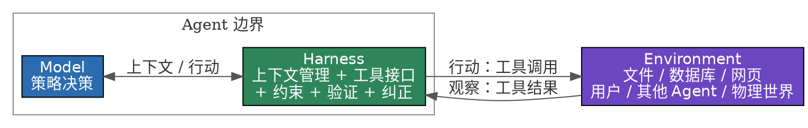
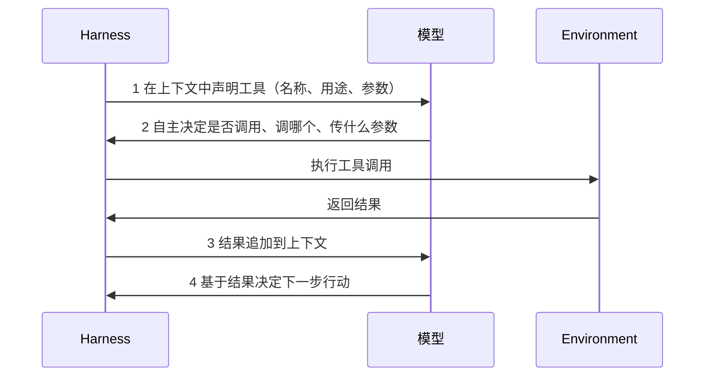
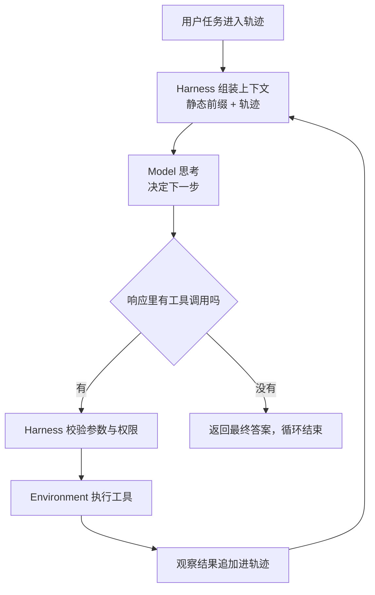
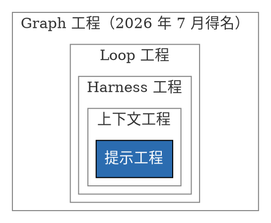
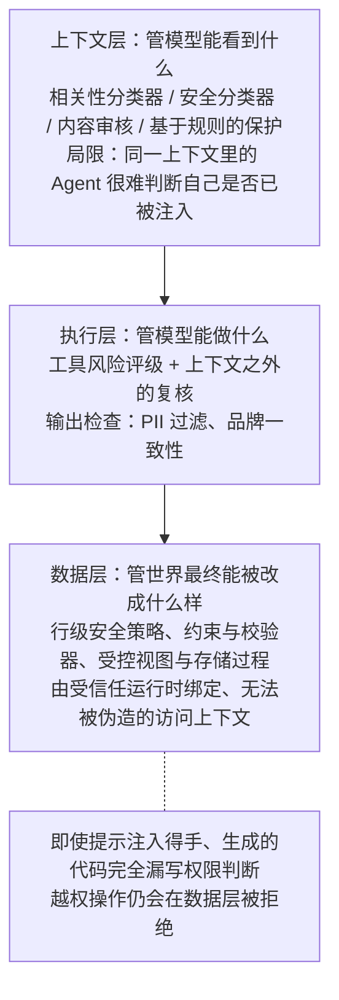

---
tags:
  - ML系统
---

> [!note] 本节要点
> - Agent = LLM + 上下文 + 工具，环境在公式之外；模型固定时，重新定义观察与动作接口往往比换模型更有效；
> - 上下文 = 静态前缀 + 轨迹：组件并不等价，衡量标准是承载的信息能否从别处重建；
> - 生产形态写作 Agent = Model + Harness，护栏按被绕过的难度分上下文、执行、数据三层，给模型短板打补丁的适配层会随模型变强被内化。

这一章是《AI Agent 入门》全书的 **概念地图** 。作者自己在开头就说明了读法：它会快速引入 Agent 的核心公式、运行循环、工程框架和设计模式，为后面九章提供统一术语，初读不必逐一记住。全章的叙事其实是三层递进的：先说 Agent 由什么组成（是什么），再说它怎么转起来（怎么转），最后说生产环境里怎么让它不转错（怎么可靠地转）。下面按这个脉络拆开讲。

## 全章结构总览

```markmap
# 第 1 章 AI Agent 入门
## 上半：Agent 是什么
### 核心公式
- Agent = LLM + 上下文 + 工具
- 大脑 / 眼睛 / 手脚
- Model ↔ Harness 双层结构
### 能力杠杆
- 观察空间与动作空间
- Manus 取并集 / OpenClaw 本地优先
### 三大组件
- 工具：五类分法 + 调用四步
- LLM：模型即 Agent、苦涩的教训
- 上下文：五组件 + 消融实验 1-1
### 运行机制
- ReAct：想 → 做 → 看
- 上下文 = 静态前缀 + 轨迹
- 实验 1-2 Kimi K3 / 1-3 GPT-5.6
## 下半：怎么可靠地跑
### Harness 工程
- 五要素：上下文、工具、约束、验证、纠正
- LangChain 52.8% → 66.5%
### 范式演进
- 提示 → 上下文 → Harness → Loop → Graph
### 三个绕不开的决策
- 模型选型
- 编排模式：工作流 / 自主 / 混合
- 护栏：上下文层 / 执行层 / 数据层
## 五个贯穿全书的设计模式
```

## 一、核心公式与它的两条边界

开篇先用 Cursor、Deep Research、Manus、豆包手机助手、Pine AI 五个产品做钩子：形态各异，共同点是从「你问一句它答一句」升级为 **自主规划步骤、调用工具、根据结果调整策略** 。然后给出最小工程公式：

$$
\text{Agent} = \text{LLM} + \text{上下文} + \text{工具}
$$

作者立刻补了两个限定，这两个限定比公式本身更重要：

- 加号表示 **工程组件的组合** ，不是强化学习里的形式化定义。
- 公式只描述 Agent 边界之内，**Environment（环境）在公式之外** 。文件、数据库、网页、用户、其他 Agent、物理或仿真世界都属于环境，Agent 只能通过观察和行动接口与它交互。

三个组件各有一个身体隐喻，并且能映射到学术概念：

| 直觉理解   | 实现组件   | 学术概念       | 含义                             |
| ------ | ------ | ---------- | ------------------------------ |
| **大脑** | LLM    | 策略（Policy） | 决定「下一步做什么」的决策逻辑，从可选行动中挑出最合适的一个 |
| **眼睛** | 上下文构造  | 观察与历史      | 把环境返回的观察与已有历史组织成当前决策所需的信息      |
| **手脚** | 工具与适配器 | 观察 / 行动接口  | 规定能读哪些观察、能发哪些行动、接口用什么格式        |

作者强调这三者与 RL 的策略和交互接口是「可以映射，但不严格等同」：上下文是观察和历史在 Agent 内部的表示，不等于整个观察空间；工具定义的是接口，接口背后的对象仍属于环境。

### 图 1-1 的双层结构



三条容易被读快、但后面反复要用到的判断：

1. **Harness 可以创建、隔离或代理一个环境，却不因此包含环境自身的状态与转移规律** 。工具定义、调用适配器、沙箱的权限与重置机制属于 Harness；沙箱内随行动变化的文件和进程、外部数据库、网页属于 Environment。
2. **物理部署位置不决定概念归属** 。即使仿真环境与 Agent 跑在同一个进程里，它仍然是 Environment。
3. 开头的工程公式可以据此重写：LLM 对应 Model，「上下文 + 工具」构成最小 Harness，生产系统再在 Harness 中加入约束、验证和纠正。

## 二、全章最实用的一条论断：扩展接口比换模型更有效

> 在底层模型固定时，提升 Agent 任务表现最主要的系统工程手段，往往就是重新定义或扩展观察空间与动作空间。

推理很朴素：没有通过观察通道进入上下文的信息，对模型来说就像不存在；没有被动作接口允许的操作，模型即使知道该怎么做，也只能停留在文字建议上。所以许多看似需要「更聪明模型」的问题，其实只是接口问题。

两个产品案例支撑这条判断：

- **Manus：合并原本分离的空间** 。在它之前，Deep Research、Coding、Computer Use 是三条相对独立的生产级路线。Manus 的突破是率先把三者放进同一个有广泛影响力的 Agent：虚拟浏览器扩大观察空间，文件系统、代码执行与命令行执行扩大动作空间。它靠的是三类 Agent 两个空间的 **并集** ，不是换一个更强的模型。
- **OpenClaw：把接口延伸到用户的数字生活** 。通过 WhatsApp、Telegram、Slack、Discord、iMessage 等消息渠道接收任务和返回结果，同时用本地 Gateway 连接 Google Drive、Notion 和本地文件系统，分散在不同账号与设备中的文件在授权后进入同一个观察空间。相比早期 Manus 以隔离云端沙盒为中心的形态，本地优先跨越了更大的数据边界。

作者还补了一笔很有意思的反证：Manus 后来也加入了 Google Drive 连接器和桌面端本地访问，并在 2026 年 3 月发布 My Computer 时把「重要工作位于本地而非云端」称为云沙盒的根本局限。**产品能力的演进史，往往就是观察空间和动作空间的演进史** 。

## 三、工具：Agent 的手脚

按 Agent 与外界互动的方向，工具分成五类：

| 类别 | 承载方向 | 代表场景 |
|---|---|---|
| **感知工具** | 环境 → Agent | 搜索引擎、文件系统读取、API 与数据库 |
| **执行工具** | Agent → 环境 | 代码执行、文件操作、系统命令、外部 API 调用 |
| **协作工具** | Agent ↔ Agent / 人 | 委托子 Agent、关键决策点请求人类确认、多 Agent 协调 |
| **事件触发工具** | 环境 → Agent（驱动启动） | 新邮件、预定时间点、Webhook 回调 |
| **用户沟通工具** | Agent → 用户 | 文字消息、语音通话、邮件 |

第四类有个本质区别：它 **不由 Agent 主动调用** ，而是作为外部输入激活 Agent。作者解释了为什么仍把它归入工具体系——事件适配器同样是 Environment 向 Agent 提供观察的通道。

### 工具调用四步

**工具调用**（Tool Calling，也称 Function Calling）把 LLM 从纯文本生成器变成能执行操作的系统，四步流程就是后面 ReAct 的基础：



开发者只负责「定义工具」和「执行工具调用」，「要不要调、调哪个、传什么参数」这三件事由模型自主完成。

### 工具设计的核心原则

作者给出一条辩证得很清楚的取舍：

> **通用基础能力用于组合与探索；专用工具用于约束高风险和强业务规则操作。**

- **从最窄能力起步** ：只做四则运算，一个参数清晰的计算器就够。
- **随复杂度升级** ：任务变成读表格、清洗缺失值、算统计量、绘图时，受限的 Python 代码解释器比不断叠加专用工具更容易组合和探索。长程任务（数小时到数天）则需要受控的虚拟工作目录，同时保存计划、中间结果、运行日志和最终产物，让 Agent 能跨多次执行接续工作。
- **通用性同时扩大出错面和攻击面** ：代码必须在隔离沙盒中运行，默认不能访问网络，不能读授权工作目录以外的文件，并对执行时间、CPU、内存和输出大小设上限；工作目录也要限定路径、容量、文件类型，防止路径越界。
- **高风险操作仍走专用工具** ：支付、删除数据、发送邮件、生产部署应封装为参数明确、权限受限、全程可审计的专用工具，必要时加预览和人工确认。

作者还预告了一句：接口定义不清晰模型就会乱用工具，错误处理不到位工具一失败 Agent 就可能死锁，权限太宽泛出错后果难以挽回。完整体系在第四章。

## 四、LLM：大脑与「模型即 Agent」

LLM 的独特能力是 **内部思考** ：在采取实际行动之前先规划推演，这个过程不改变外部环境，却能显著提升后续行动的质量。它能有效推演的原因来自预训练——模型遵循的是人类知识中沉淀下来的逻辑规则、数学定律、因果关系和问题分解策略。所以与传统 RL Agent 不同，今天的 Agent 不是盲目随机探索，而是在结构化知识体系上展开。

### 「模型即 Agent」与一个必须澄清的区分

先进模型通过后训练（特别是强化学习）把工具调用内化为原生能力：何时调用、调哪个、传什么参数都由模型自己决定，无需人工编排。作者在这里专门澄清了一个常见误解（并在脚注里感谢读者通过 Issue #30 指出）：

- **强化学习写进参数的是决策** ：何时该调用工具、调用哪个、传什么参数、拿到结果后是否继续、如何把几十上百次调用串联成连贯推理。
- **工具本身及其执行由 Agent 框架或 API 内置工具提供** ：`web_search`、`code_runner` 的真实实现、代码沙盒环境、调用的发起与结果回传，都在模型之外的基础设施里完成（Kimi 通过名为 Formula 的服务端脚本引擎运行官方工具）。

所以编排循环并没有消失，只是决策权交给了模型；循环本身跑在哪里，取决于接入方式。这一点在下面两个实验里会得到具体印证。

### Harness 会不会被模型「吃掉」

作者引 Rich Sutton 的《苦涩的教训》提出这个问题：AI 研究七十年间，研究者一次次把领域理解编码进系统，短期见效，长期总输给能随算力与数据扩展的通用方法。本书的立场概括成八个字——**方向认同，节奏务实** ：

- **方向上** 不怀疑模型会持续吃掉 Harness：工具调用、长程规划都曾靠外部编排，如今已是原生能力。
- **节奏上** 这个「吃」的过程远比想象中慢：训练以月计，模型也无法一次内化真实业务中所有的约束与偏好。
- 结论：**模型此刻的能力边界，就是 Harness 此刻的价值所在** 。Harness 工程不是对苦涩教训的抵抗，而是它在工程时间尺度上的实践——模型还做不稳的 Harness 先补上，模型每内化一层，Harness 就卸下一层，转而兜底新的能力前沿。

Harness 这个词本身也解释得很到位：原指马具，套在马身上的缰绳与挽具不是为了限制马的奔跑能力，而是把这种力量引导到正确方向。模型是那匹强大但不可预测的马。

### Agent 的三条学习路径

行为改变不只发生在训练阶段。按更新发生的位置和持续时间分三条互补路径（图 1-2），排列顺序正好是可回滚程度从高到低：

| 路径 | 发生位置 | 优势 | 局限 | 详见 |
|---|---|---|---|---|
| **上下文适应** | 当前任务内 | 快速、低成本，立即生效 | 受上下文窗口与信息组织方式约束，不改变下一次会话 | 第二章 |
| **外部产物更新** | 知识文档、Prompt / Skill、程序与 Harness | 可审计、可修订 | 执行时仍需通过上下文或工具接口被使用 | 第三至五章、第九章 |
| **参数更新** | 后训练 | 形成自然、广泛的泛化能力 | 部署成本较高 | 第八章 |

参数更新适用于医疗影像理解、语言风格、隐式决策策略这类外部规则难以完整表达的高维能力。三者是不同时间尺度上的协同机制：上下文负责临场适应，外部产物负责可控积累，参数负责内化难以显式表达的能力。

## 五、上下文：五个组件与一次消融实验

上下文是 Agent 在每个决策点能看到的全部信息，相当于它的「视野」。从 API 视角看，每次调用 LLM 的上下文由五部分构成：

1. **系统提示词** ：开发者编写、整个对话中保持不变，相当于 Agent 的「岗位说明书」，定义身份、权限、行为准则。里面还会包含跨会话保存的 **用户记忆** 和动态注入的环境状态。
2. **工具定义** ：可用工具的名称、功能描述、参数格式。它与系统提示词一起构成 **静态前缀** 。（2026 年以来，生产框架中工具的完整 schema 也可以按需动态加载到上下文末尾而不破坏前缀。）
3. **用户消息** ：用户输入，可能包含通过 RAG 动态检索引入的 **外部知识** 。
4. **模型回复** ：最多三部分——思考过程 `reasoning`、文本内容 `content`、工具调用请求 `tool_calls`。一次回复中三者不一定同时出现：决定调用工具时通常只有 `reasoning + tool_calls`，给出最终回答时通常只有 `reasoning + content`。
5. **工具执行结果** ：框架执行工具后返回的结果，是下一步思考的直接依据。

于是得到全章的一个关键等式：

$$
\text{Agent 上下文} = \underbrace{\text{系统提示词} + \text{工具定义}}_{\text{静态前缀}} + \underbrace{\text{用户消息} + \text{模型回复} + \text{工具结果}}_{\text{轨迹，随交互不断增长}}
$$

### 实验 1-1：消融实验揭示组件并不等价

方法学是 **消融实验**（Ablation Study），像医生逐一排除病因：一组保留全部组件的完整基线，加上四组各缺失一个组件的对照。系统提示词不参与消融，因为没有它 Agent 连基本角色认知都没有，测试没有意义。

| 被去掉的组件 | 后果 | 关键洞察 |
|---|---|---|
| **工具定义** | 无法调用任何工具 | 但失去行动能力不等于沉默：模型照样给出格式工整、语气笃定的答案，数据来自参数记忆，排版与真正基于观测的答案一模一样。坦白拒绝还是就地编造，主要取决于模型自身的幻觉率与诚实度；提示词里「不得自行估计」只能降低概率，不能消除 |
| **工具执行结果** | 闭环控制断裂 | Agent「盲目」执行，反复重试直到耗尽迭代预算 |
| **思考过程** | 几乎没有代价 | 前提是「为什么这么做」可以从「发生了什么」重建 |
| **历史消息** | 冗余操作、重复犯同样的错误 | 轨迹的防重复价值 |

两句核心洞察值得单独记住：

> **上下文决定了 Agent 能看到什么，而 Agent 只能基于它看到的信息做决策。** 组件并不等价，衡量标准是它承载的信息能否从别处重建。

> **「给出了回答」不等于「完成了任务」** 。上下文残缺时典型的失败不是报错退出，而是一个看上去毫无破绽的答案。

作者还补了一句方法学提醒：同一个消融换到新模型上完全可能得出不同结论，这类论断要靠实测。

## 六、ReAct 循环：三大组件如何协同

ReAct 名字只体现 Reasoning 和 Acting 两个词，实际循环包含三个环节：**想（思考）→ 做（调用工具）→ 看（观察结果）** ，不断重复直到任务完成。

最小运行骨架说明的是分工：**Model 只负责决定下一步，Harness 负责组装上下文、校验并执行工具，Environment 负责产生真实状态变化和观察** 。

```python
trajectory = [user_request]

repeat:
    context = stable_prefix + trajectory
    decision = Model(context)
    trajectory.append(decision)

    if decision has no tool call:
        return decision.answer

    for call in decision.tool_calls:       # 独立调用可并行
        validated_call = Harness.validate(call)
        observation = Environment.execute(validated_call)
        trajectory.append(observation)
```



### 多币种汇总的例子

书里用一个具体任务展示轨迹长什么样：Q1 2.5M 美元、Q2 2.1M 欧元、Q3 1.8M 英镑、Q4 380M 日元，求年度总收入和季度平均。

| 季度 | 原始金额 | 折合美元 |
| --- | --- | --- |
| Q1 | 2.5M USD | 2,500,000 |
| Q2 | 2.1M EUR | 2,282,608.7 |
| Q3 | 1.8M GBP | 2,278,481.01 |
| Q4 | 380M JPY | 2,541,806.02 |

执行过程是：第一次迭代并行发起 3 个 `convert_currency` 调用（EUR、GBP、JPY → USD），第二次迭代用 `code_interpreter` 汇总，第三次迭代生成最终答案。**整个过程只用了 3 次迭代、4 次工具调用** ，总收入 $9{,}602{,}895.73$，季度平均 $2{,}400{,}723.93$（我核算过，四项相加与除以 4 都对得上）。

轨迹里有三点值得注意：

- 系统提示词和工具定义没有出现在轨迹中，它们作为静态前缀在每次调用时自动拼接在前面。
- 每次调用 LLM 都能看到完整轨迹，所以它清楚任务进行到哪一步、此前尝试过什么、得到了什么结果。
- 轨迹的结构化让系统易于解释和调试；分析大量轨迹还能发现行为模式、优化决策路径、改进工具设计，轨迹也可以沉淀进知识库或用于强化学习训练，形成从经验中学习的闭环。

顺带解释思考题 2 的背景：正因为每轮都重读全轨迹，$n$ 轮、平均每轮 $m$ 个 token 时累计缓存读取量约为 $\sum_{i=1}^{n} i \cdot m \approx \frac{n^{2} m}{2}$，即 $O(n^{2})$ 增长。这是第二章上下文压缩要解决的问题。

## 七、两个实验对照：同一个范式，两种循环归属

| 维度 | 实验 1-2：Kimi K3 | 实验 1-3：GPT-5.6 |
|---|---|---|
| 模型特征 | 约 2.8 万亿参数 MoE，100 万 token 上下文，原生视觉理解，思考模式始终开启 | 支持自由格式工具调用（`type: "custom"`） |
| 谁决定调用 | 模型（RL 内化决策策略） | 模型 |
| 工具在哪执行 | 服务端 Formula 脚本引擎 | Responses API 内置 `web_search` 与代码解释器，服务端闭环 |
| ReAct 循环谁驱动 | **客户端代码** （`agent.py` 里的 `while` 循环） | **服务端闭环** ，客户端不必自建编排框架 |
| 突出能力 | 长链工具调用稳定性：连续 200～300 次调用保持思考一致，远超多数模型几十次后退化 | 「搜索 → 阅读 → 分析 → 再搜索」的迭代研究，外加 **意图澄清** |

两个细节值得单独说：

- **自由格式工具调用** 允许模型直接向工具发送原始文本（一段 Python、一条 SQL），省去 JSON 转义。作者明确定性：这是 API 参数格式的演进，不是模型架构的革新，客户端「检测 `tool_calls` → 执行 → 回传结果」的循环逻辑保持不变。
- **意图澄清** 把 Deep Research 的产品设计理念内化到了模型层。面对「搜索最近一个月的比特币走势，做技术分析」，GPT-5.6 会先问「你偏好哪个数据源？需要分析哪些技术指标？」，让「用户说了什么」和「用户真正想要什么」之间的差距在执行之前就得到弥合。

作者也说明这个实验不绑定厂商：阿里云百炼 qwen3.7-plus 的 Responses API 同样内置 `web_search` 与 `code_interpreter`，Kimi K3 的 Formula 托管搜索与 `code_runner` 属同类能力。

MoE 这个概念书里给了个很易懂的比喻：想象成一个专家团队，面对不同类型的问题，系统自动选择最合适的几位专家作答，不需要所有专家同时上阵，既保证能力又提高效率。

## 八、Harness 工程：从「能做事」到「可靠地做事」

前半章证明了基本机制有效，也暴露了脆弱点：模型可能幻觉出工具或参数、选错工具、遇错无法自我恢复。一个能跑的 Demo 和一个可靠的产品之间有巨大鸿沟。生产形态下公式展开为：

$$
\text{Agent} = \text{Model} + \text{Harness}
$$

$$
\text{Harness} = \text{上下文管理} + \text{工具接口} + \text{约束} + \text{验证} + \text{纠正}
$$

$$
\text{Agent} \leftrightarrow \text{Environment}
$$

### 五要素分工

| 功能 | 职责与核心原则 | 实际例子 | 详见 |
|---|---|---|---|
| **Context 上下文** | 提供感知信息；信息要充分，让每个决策点都基于足够信息判断 | 系统提示词、知识库、Agent 状态栏、Sidecar 旁路查询 | 第二、三章 |
| **Tools 工具接口** | 提供观察与行动手段；接口要清晰，命名直观、参数有例子、边界有说明 | MCP 工具、代码解释器、搜索工具 | 第四章 |
| **Constrain 约束** | 设定行为边界；故障安全默认值，所有能力默认关闭，必须显式开放 | Claude Code 中每个工具默认需要用户授权 | 第四章 |
| **Verify 验证** | 自动判断操作结果对错；安全检查只看结构化数据（如工具返回的 JSON 字段），不看模型自由生成的文本，因为后者可能已被提示注入操纵 | Linter 检查、类型系统、工具调用结果校验 | 第五、六章 |
| **Correct 纠正** | 发现问题时自动修正或回退；确认无法恢复之前不暴露中间态 | 静默重试、接续生成、连续失败时熔断回退人工 | 第二、五章 |

记忆法：**上下文与工具让 Agent「能做事」；约束预防错误、验证发现偏差、纠正使闭环形成，三者让 Agent「不做错事」** 。约束的类比是手机 App 权限管理；熔断器（Circuit Breaker）的类比是家里电路短路时保险丝自动跳闸。

模型控制循环的伪代码把五要素串了起来：

```python
observation = Environment.observe()
trajectory = [observation]
while True:
    actions = Model(Harness.build_context(trajectory))
    if len(actions) == 0:
        break
    allowed_actions = Harness.constrain(actions)
    observation = Environment.apply(allowed_actions)
    if not Harness.verify(Environment):
        observation = Harness.correct(Environment)
    trajectory.append(allowed_actions, observation)
```

### 成熟度曲线上两类功能的重要性不对称

早期 Agent 框架主要关注上下文与工具，给模型工具、给模型上下文，让它能做事。生产级系统的重心已经转向约束、验证与纠正。作者给了两个证据：

- **Claude Code** ：Harness 中绝大部分代码是约束、验证与纠正，工具本身（文件读写、命令执行、搜索）只占一小部分。保障机制包括流程状态管理、多层上下文压缩、权限分类、熔断器、错误恢复（捕获异常、回滚到上一稳定状态、重试或交还人类）。
- **LangChain 在 Terminal Bench 2.0** ：这是一个评估 Agent 在终端环境中完成复杂任务能力的基准测试。

| 阶段 | 得分 |
| --- | --- |
| 改动前（排行榜 30 名开外） | 52.8% |
| 改动后（跃升至前 5） | 66.5% |

提升 13.7 个百分点，改的不是模型，而是让 Agent 自动检查自己的执行结果、检测是否陷入重复循环、优化思考策略这些工程手段。结论：**当各家模型能力越来越接近、不再是决定性差异因素时，竞争优势就转移到了模型之外的工程实践** 。

## 九、工程范式的五波演进：层层包含



$$
\text{提示工程} \subset \text{上下文工程} \subset \text{Harness 工程} \subset \text{Loop 工程} \subset \text{Graph 工程}
$$

- **提示工程** ：优化输入给模型的自然语言指令。
- **上下文工程** ：系统性管理模型能看到的所有信息（系统指令、工具定义、对话历史、外部知识）。
- **Harness 工程** ：视野从「模型能看到什么」扩展到「Agent 如何组织模型运行并与环境交互」。
- **Loop 工程** ：从单次运行扩展到跨轮次的持续自主运转——谁来发现下一件该做的事、何时验证、何时才算真正完成。
- **Graph 工程** ：把 Agent 循环、确定性程序和人工审批组织成显式执行图，节点承担具体能力，边规定路由与依赖，结构化状态沿边传递并在关键边界持久化。单个 Agent 循环正是执行图中的一个节点。作者注明这个名称在 2026 年 7 月被明确提出，但相关实践早于名称：LangGraph、Microsoft Agent Framework、Google ADK 的官方文档分别称其为图编排或 graph-based workflow。

### Anthropic 的三个核心原则

- **保持简单** ：从最简单方案开始，只在确实必要时增加复杂度。直接的 API 调用优于复杂的框架，清晰的代码优于聪明的抽象——每多一层抽象都会成为以后调试时新的盲区。
- **保持透明** ：明确显示规划步骤、执行日志和决策轨迹。这不只为调试方便，也是让用户建立信任的前提，因为黑箱里的错误一旦发生，外部观察者既无法定位也无法纠正。
- **设计好工具接口（ACI，Agent-Computer Interface）** ：从 Agent 视角而非程序员视角设计接口。容易误用的地方要从设计上让错误无法发生，比如 SIM 卡的缺角让卡片只能单向插入，微波炉门没关好就绝不加热。这种「用设计消除错误」的思路在制造业叫 **防呆**（Poka-yoke），源自丰田生产体系。理由是：模型与工具之间唯一的沟通通道就是接口本身，模糊的接口会被模型放大成系统性的错误。

## 十、模型选型：五条实操思路

作者刻意不推荐具体版本（迭代太快），给的是维度：

- **闭源** （OpenAI GPT/o 系列、Anthropic Claude 系列）能力领先，但成本高且受厂商 API 策略限制。**开源** 在本书编写时与闭源差距在 6 个月以内，成本显著更低，可私有化部署、支持微调，适合成本敏感或有数据合规要求的场景。国内 Agent 能力较强的是 DeepSeek、Kimi、GLM。选模型不要只看排行榜，**要在你自己的任务上做评估** 。
- **能力之外还要看策略边界** ：模型在基准测试中具备某种能力，不意味着承载它的产品一定允许用户调用。不同厂商对网络安全、模型蒸馏、模型提取、隐私数据和高风险操作设置的边界不同；同一个任务在聊天产品、Coding Agent 和 API 中也可能得到不同结果。业务关键任务应提前准备人工接管或其他合规模型作为替代路径。
- **绝大多数 Agent 需要支持思考（Reasoning）的模型** ：只有极少数场景例外，比如单步简单任务，或 Computer Use 中仅需点击固定位置的简单 GUI 操作。只要涉及多步思考或动态决策，就一定要选支持思考的模型。
- **关注输出 token 速度** ：Agent 往往需要多轮推理，每轮都要等模型输出完成才能执行下一步。一个需要 20 轮推理的任务，每轮慢 2 秒就意味着总共多等 40 秒。
- **关注多模态能力** ：需要理解图片、音频或视频时这是硬性要求，不同模型差异很大。

## 十一、编排模式：工作流、自主 Agent 与混合

编排模式是 Harness 中「上下文与工具」层面的组织方式，决定上下文如何在 LLM 调用之间流动、工具如何被调度、执行路径是预设还是动态生成。

总原则是 **从简单到复杂** ：首先考虑单个 LLM 调用，能靠优化提示词和上下文示例解决就不要引入 Agent 系统；需要多步骤且可清晰分解为固定子任务时用工作流；只有需要动态决策和灵活执行路径时才用自主 Agent。同时要记住：Agent 系统通常用延迟和成本换取更好的任务性能，要谨慎权衡这笔交换是否值得。

### 工作流：确定性的编排

执行路径由开发者预先设计好，LLM 只在每个节点内部负责理解和生成。订机票的例子是四个固定节点：核实用户身份 → 搜索可用航班 → 完成付款 → 确认预订。

- **优势一：严格的流程控制** 。「付款前不能预订」这类业务规则通过代码强制执行，不依赖 LLM 判断。
- **优势二：安全性** 。提示注入或模型犯错最多影响当前节点内部的处理，无法让 Agent 跳到不该执行的分支，攻击面被限制在单个节点内。
- **局限：缺乏变通性** 。用户在付款环节临时想改签、航班突然取消需要推荐替代方案，固定节点路径无法灵活应对。

文生图是最简单的工作流例子：Stable Diffusion 这类模型只接受逗号分隔的英文标签、质量词、负面提示词，所以要在用户和生图模型之间架两个固定节点——**提示词改写** （把「AGI 实现以后程序员的工作场景」这句大白话思考成具体场景描述）和 **图片生成** 。这里的 LLM 节点做的是翻译，它存在的原因是文生图模型「听不懂人话」。作者给这类专门给工具或模型的能力短板打补丁的 Harness 代码起了个名字：**适配层** 。

### 实验 1-4 与适配层的消亡

换成具备 **原生图像生成** 能力的多模态模型（Nano Banana 2、GPT-Image 2），提示词改写节点就不需要了，不管用户怎么措辞模型自己就能听懂。实验 1-4 让同一句大白话走两条路线对照：看提示词改写节点把原始需求改成了什么样，以及两条路线出的图谁更贴近原始需求；并且要分两类需求对照——描述具体的（比如指定了海报文案）和宽泛的（比如 AGI 工作场景），后者工作流路线仍可能有优势。

作者由此总结出一条贯穿本章的规律：**Harness 里那些给模型能力短板打补丁的部分，会随着模型变强被模型自己内化** 。仅仅在第一章中这样的事就已发生好几轮：

- few-shot 示例、「让我们一步一步思考」之类的提示词技巧 → 被指令微调和推理模型内化
- 输出格式修复、JSON 解析容错 → 被结构化输出和原生工具调用内化
- 文生图的提示词改写 → 被原生多模态理解与生成能力吃掉

每一轮内化，消灭的都是「翻译」和「脚手架」这类适配层代码。

### 自主 Agent：动态决策

执行路径由 Agent 根据 **环境反馈** 实时决定。还是订机票：用户说「帮我订下周三去上海的机票」，Agent 自行决定先搜索航班、发现需要登录于是先核实身份、再回来搜索、发现最便宜的航班需要转机、主动询问用户是否接受、用户说不要转机、Agent 调整搜索条件。

自主 Agent 需要自主规划能力，还需要能识别失败、调整策略，而不只是在出错时停下来。但自主性不等于无限制，必须设计明确的 **停止条件** ，否则容易陷入死循环或过度执行。常见退出条件：调用最终输出工具、模型返回没有任何工具调用的响应、遇到错误、达到最大轮数。

从实现角度看，自主 Agent 就是在循环中使用工具的 LLM，即 ReAct 循环。它特别适合开放式问题——难以预测所需步骤数量的问题，典型场景包括 Coding Agent 解决 SWE-bench（评估 Agent 自动修复真实 GitHub Issue 能力的基准测试）任务、Computer Use Agent 操作计算机界面、需要迭代搜索和分析的研究任务。代价是更高成本和复合错误风险，因此部署时必须在沙盒环境充分测试、设置护栏和监控、在关键决策点加入人机协作检查点。

### 混合，以及一个反面教材

两种模式并非非此即彼。n8n 这样的可视化工作流自动化框架允许在同一系统中同时使用工作流节点和自主 Agent 节点。还有一种混合方式是 **先由自主 Agent 把工作流写出来，再由工作流去执行** ：Agent 读完任务后自行决定拓扑并生成编排代码，代码一旦生成，执行阶段就退回工作流的确定性。

反面教材写得很生动：为「从百万条聊天记录中提炼个人记忆」设计 Agent，一些 AI 模型很容易迅速画出一条看似严谨的流水线——切分对话片段，再依次安排提取、证据核验、身份解析、记忆整理和合并复核 Agent，最后建立事实图、覆盖账本和不可变版本。每个部件单看都有道理，组合起来却非常低效、不可靠。原因是复杂工作流的执行拓扑是固定的，遇到新的例外系统很容易继续增加节点，架构越来越复杂，通用性却越来越差；模型原本可以根据上下文处理的语义判断，反而被工作流写死了。

所以 **Harness 很重要，不等于 Harness 越复杂越好** 。Manus 官网用「Less structure, more intelligence.」概括这种取舍：先给一个能力足够的 Agent 清晰的目标、必要的上下文和可组合的工具，用自然语言告诉它如何像人一样查证、比较、处理冲突；程序只固化权限、不得覆盖原始材料、原子发布等必须始终成立的边界。只有业务约束本身要求，或评估反复暴露出某类稳定失败时，才把对应步骤升级为专门的验证器、独立 Agent 或确定性流程。

### 主流框架速览

书中对比了 Codex Harness、Claude Agent SDK、LangChain/LangGraph、n8n、Dify、CrewAI、OpenClaw、DeepSeek Harness、Pi 九个框架，并专门澄清了一个易混点：**Codex 是 OpenAI 的 Coding Agent 产品（App、CLI、IDE 扩展），Codex Harness 是驱动这几种形态的那一层开源运行时** ，提供三条集成路径——`codex exec` 适合脚本与 CI 里的一次性任务，Codex SDK 适合第三方应用代码启动、恢复和流式处理任务，app-server 通过 JSON-RPC 提供持久会话、事件流与审批回调。Claude Agent SDK 与 Claude Code 关系类似，区别是 Claude 侧对外开放的是 SDK 接口，Harness 实现本身不开源。

作者的态度很清醒：框架发展迅速，学会某个具体框架的用法并不重要，关键考量是它能否用尽可能少的抽象层让你专注于业务逻辑。

## 十二、护栏与安全：按「被绕过的难度」分三层

**护栏**（Guardrails）是保障 Agent 行为安全可控的分层防线，可用于管理数据隐私风险（防止系统提示泄露）或声誉风险（确保模型行为与品牌形象一致）。实践中先针对已识别的风险设置护栏，再在发现新漏洞时逐步添加；单个护栏不太可能提供足够保护，多个专门的护栏组合使用才能构建更有韧性的系统。

三层顺序不是按请求处理的先后排的，而是按 **被绕过的难度** 排的——越靠下的层越不依赖模型自己的判断，因此越难被一次成功的攻击穿透。



### 上下文层

四种机制：

- **相关性分类器** ：标记偏离主题的查询，比如编程助手收到「帝国大厦有多高？」
- **安全分类器** ：检测越狱和提示注入。两者的关键区别是——**越狱** 是用户自己试图绕过模型的安全限制，**提示注入** 是攻击者通过外部数据（网页内容、文档）间接操纵模型行为。
- **内容审核** ：标记暴力、歧视性等有害输入。
- **基于规则的保护** ：黑名单、输入长度限制、正则表达式过滤器等确定性措施，防范 SQL 注入等已知威胁。来源标注与「指令 / 数据」分离也属于这一层。

工业实践代表是 Anthropic 的 Constitutional Classifiers，三点机制：

1. **规则驱动** ：用自然语言写成的规则生成合成训练数据，训练输入输出分类器。
2. **上下文联合判断** ：把用户提问和模型回答放在一起检查。有些回答单独看毫无问题（如「如何使用食品调味料」），只有对照提问才能发现「食品调味料」其实是化学试剂的暗语。
3. **两级筛查** ：先用极轻量的探针（直接读取模型内部激活，几乎零成本）检查所有对话，发现可疑之处再交给更强的分类器复审，而不是直接拒绝。这样第一级即使误报较多也不影响用户体验，成本也大大降低。

这一层有个 **结构性上限** ：处在同一个上下文里的 Agent，很难判断自己是否已经被注入。所以它只能降低攻击成功率，给不出保证——这正是必须有下面两层的原因。

### 执行层

核心是 **工具风险评级** ：根据操作是否可逆、权限等级、财务影响，为每个工具标注低/中/高风险，高风险操作需额外审查或人工确认。关键约束是这类复核必须由 **上下文之外** 的机制完成——独立的审查进程、最小权限凭证、沙盒隔离、人在回路——否则它会和被注入的 Agent 一起沦陷。

返回给用户的回复本身也是一次动作（第四章把它归为用户沟通工具），所以 **输出检查** 同属这一层：PII 过滤器审查输出中的个人身份信息（身份证号、手机号），输出验证通过内容检查确保回复与品牌价值一致。

### 数据层

把「谁能对哪条数据做什么」交给一层稳定的、经过人类审查的机制强制执行：数据库的行级安全策略、约束与校验器、受控视图与存储过程，以及由受信任运行时绑定、无法被伪造的访问上下文。这一层的价值在于它不依赖上面两层是否正确。

### 人工干预与误拒绝

**人工干预**（Human in the loop，又称人在回路）让 Agent 在不损害用户体验的情况下提升实际性能，在部署早期尤为重要，有助于识别失败模式、发现边缘情况并建立健壮的评估周期。它让 Agent 能在无法完成任务时平稳移交控制权：客户服务中升级到人工客服，Coding Agent 中交还给开发者。两种触发情况：

- **超过失败阈值** ：为重试次数或操作次数设置上限，超过就升级到人工干预。
- **高风险操作** ：涉及敏感、不可逆或高风险的操作，至少在团队对 Agent 可靠性建立起足够信心之前应触发人工监督，典型例子是授权大额退款或付款。

还有一类容易被漏掉的失败：**误拒绝** 。为了降低危险请求被放行的概率，模型可能同时拒绝一部分合法但形式敏感的任务，例如经过授权的安全测试、模型蒸馏研究。因此护栏评估不能只测「应当拒绝的请求是否被拦截」，还要测「明确允许的请求是否能够正常完成」。

## 十三、别记住两套骨架

作者专门澄清了两个公式的关系：全书的结构骨架只有一个，就是 **Agent = LLM + 上下文 + 工具** 。第二至六章讨论构建，第七至九章讨论评估与进化，第十章讨论协作。**Agent = Model + Harness** 不是与它并列的另一套划分，而是同一事物在生产形态下的展开，把「上下文」和「工具」细分为五项职责，因此是构建部分内部的一个观察视角。

| Harness 要素 | 对应章节 | 核心内容 | 安全关注点 |
|---|---|---|---|
| 上下文管理 | 第二章（上下文工程） | 提示工程、Agent 状态栏、上下文压缩、Agent Skills | 提示注入、上下文污染 |
| 上下文管理（跨会话） | 第三章（用户记忆和知识库） | 用户记忆、RAG、结构化索引、智能体化 RAG | 敏感信息暴露、隐私保护 |
| 工具接口与约束 | 第四章（工具） | 工具分类、权限控制、MCP 标准、主动工具发现 | 误操作、未授权访问、不可逆操作 |
| 验证与纠正 | 第五章（Coding Agent 与通用 Agent） | Coding Agent 的 Harness、测试驱动、代码化规则 | 身份冒用、责任归属 |

第六章（交互）不属于五要素中的任何一项，它扩展的是观察与动作空间本身的 **模态与时机** ；第七至九章讨论怎么知道 Harness 建对了、以及怎么让它持续变好；第十章把单个 Agent 的 Harness 换成多个 Agent 的协作结构。安全同样不按章划分，它是贯穿全书的 **横切关注点**（Cross-cutting Concern，即一个影响系统多个部分的问题），按三层护栏组织。

收尾例证是 Anthropic 构建长时运行 Agent 的实践：将复杂任务分解为「初始化 Agent」（设置环境、分解任务列表）和「执行 Agent」（在每个会话中增量推进并留下清晰的交接产物），通过结构化的 Harness 解决了 Agent 在长任务中「上下文耗尽」和「过早声明完成」的问题。

## 十四、五个贯穿全书的设计模式

这批模式后面各章会反复调用，作者在这里一次性命名并给出规范定义：

| 模式 | 核心思想 | 关键前提与洞察 |
|---|---|---|
| **提议者—审核者** | 产出与评判由两个不共享上下文的角色分别承担，评判方看到的是产物本身（渲染结果、测试输出、结构化调用参数），而不是产出方的推理过程 | 成立前提是 **自审不可靠** ：同一个上下文中的模型难以发现自己的认知盲区，也很难判断自己是否已被注入。第三章更新知识、第四章工具调用事前审批与事后验证（Sidecar 是只读变体）、第五章 PPT/视频/日志三个实验、第七章评估 UI、第九章审核更新提案、第十章对等协作都用它 |
| **渐进式披露** | 不把全部信息一次性放进上下文，先给一份可检索的目录，再按需加载细节 | 同时优化上下文预算与选择精度。第二章 Agent Skills 是最典型形态（元数据常驻、正文按需加载），第三章分层检索、第四章主动工具发现与分页截断、第十章 Agent 发现都是变体 |
| **只增不改** | 状态以追加方式演进，已经写下的内容不再回头修改 | 换来可缓存、可重放、可审计。第二章 KV Cache 前缀稳定性是它的性能形态——改动越靠前，作废的缓存越多；第三章事件式记忆、第四章把新工具 schema 追加到轨迹末尾而不是插回前缀，都是同一条纪律 |
| **边界集 + 保留集** | 任何一次修改都要同时在「它应当改变的那批样本」和「它不应当影响的那批样本」上验证 | 只测前者会把过拟合当成进步，只测后者会把无效修改当成安全。第七章回归任务、第八章训练与评估隔离、第九章更新提案验证都建立在这对集合上 |
| **最小 diff + 可回滚** | 每次修改尽量小、带来源、可单独回滚，而不是整体重写 | 让归因成为可能，出了问题能定位到具体哪一次改动。三条更新路径正是按可回滚程度从高到低排列的 |

## 十五、如果只带走几句话

1. **Agent = 大脑 + 眼睛 + 手脚** ，三者缺一不可；模型固定时，扩展眼睛和手脚（上下文与工具）往往能直接把原本不可解的任务变为可解。
2. **上下文是决定性因素** ：上下文 = 静态前缀 + 轨迹；组件不等价，衡量标准是信息能否从别处重建；而上下文残缺时的典型失败不是报错，是一个看上去毫无破绽的答案。
3. **Harness 是竞争力所在** ：模型能力正在商品化，真正的差异在约束、验证与纠正，让 Agent 从「能做事」变成「可靠地做事」。
4. **从简单到复杂** ：先单次 LLM 调用，再工作流，最后才是自主 Agent；给模型短板打补丁的适配层会随模型变强被内化。
5. **安全是架构问题** ：从第一行代码就要考虑，护栏按被绕过的难度分三层，越下层越不依赖模型自己的判断。

## 思考题里几道难题的切入思路

章末 10 道题按 ★ 到 ★★★ 标注难度，不设标准答案。几道值得做的：

- **题 2（★★★）降低缓存读取量的二次方增长** ：根源是每轮全量重读轨迹。可组合的手段包括上下文压缩与摘要、把 `reasoning` 从历史中丢弃（消融实验已证明它可从工具结果重建）、维持前缀稳定以保住 KV Cache（只增不改）、把中间产物落盘到文件让轨迹只保留指针。
- **题 4（★★）除工具结果缺失外还有哪些情况会让 Agent 陷入循环** ：工具持续返回相同错误、模型反复调用同一个失败工具、参数在两个值之间震荡、目标不可达但没有失败信号、外部依赖超时。检测机制可以数连续相同调用、对轨迹做相似度去重、设置迭代预算与时间预算；终止机制是熔断器加回退人工。
- **题 7（★★★）动态风险评估** ：`delete_file` 删普通文件和删系统文件风险不同，说明等级不能只绑定工具名。可行方向是按参数运行时取值重新计算风险（路径白名单、目标是否可恢复、影响范围），配合 dry-run 预览，高风险参数组合触发人工确认。
- **题 8（★★）受限动作空间何时更优** ：高风险不可逆操作、强合规流程、需要可证明正确性的场景、低延迟要求、以及模型能力不足以稳定选择的情况。
- **题 10（★★★）会随模型迭代过时的工程手段** ：本章已经给了现成答案——few-shot 示例、「让我们一步一步思考」、JSON 解析容错、文生图提示词改写。它们的共同点是都在给模型的某项短板打补丁，而设计原则（保持简单、保持透明、ACI 防呆、三层护栏）穿越模型周期。

相关笔记：[[AI Agent Book 课程总览|课程总览]]