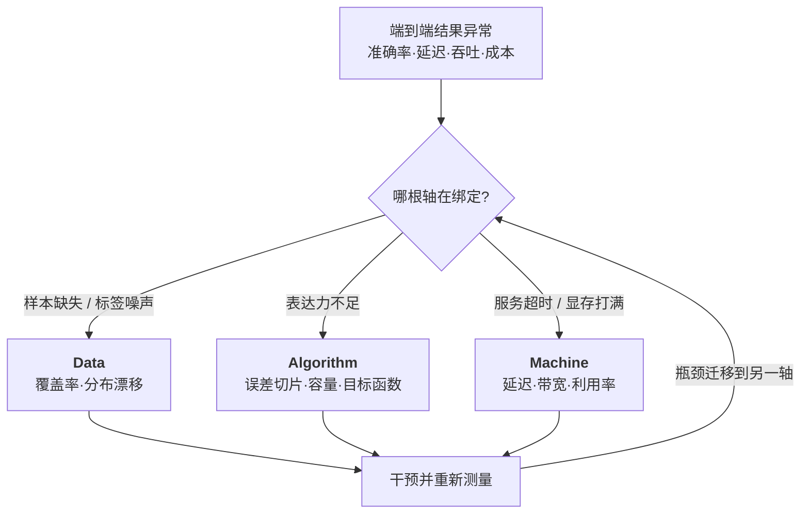
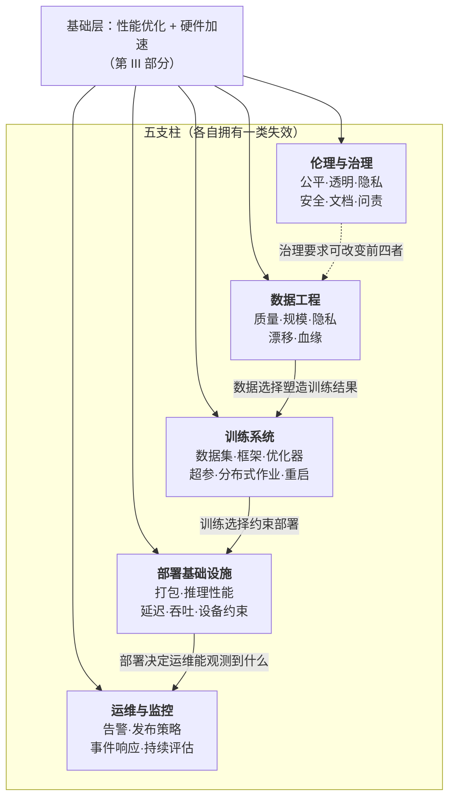

---
tags:
  - ML系统
---

原文：https://mlsysbook.ai/vol1/introduction/introduction.html

> [!note] 本节要点
> - 全章的中心主张：ML 系统受物理规律支配，而不是受意图支配，一条铁律方程（数据项 + 计算项 + 延迟项）贯穿全书三部分；
> - 诊断先于优化：用 D·A·M 三轴找出绑定约束，只打那一项并重新测量；静默退化要靠监控输入分布与标注结果来发现；
> - 苦涩的教训告诉你规模有效，铁律与 RoC 告诉你怎么负担得起；效率与规模是 Jevons 式正反馈。

## 这是什么文章

`mlsysbook.ai` 第一卷的 **第 1 章：Introduction to Machine Learning Systems**——一本 ML 系统教科书的导论章。它不讲怎么写模型，而是回答一个更前置的问题：

> **为什么造机器学习系统需要一套跟传统软件完全不同的工程原则？**

全章的中心主张浓缩成一句话：**ML 系统受物理规律支配，而不是受意图支配**（governed by physics, not by intention）。数据在带宽约束下穿过存储层级，算术在功耗约束下跑在硅片上，预测必须在延迟窗口内到达。这些不是实现细节，而是从模型架构到部署目标的设计变量。

由此推出全章反复回到的 **双重使命（dual mandate）**：

- 学到的行为必须**可信**（准确、随世界变化仍能成立）
- 机器必须能在**时间、内存、能耗、成本**预算内产出这个行为

准确但太慢的模型没法用；快但训练数据不具代表性的模型，是“以机器的速度犯错”。

## 全章骨架

```markmap
---
markmap:
  highlight: false
---
# 第1章 ML 系统导论
## 1.1 数据中心范式转移
- Software 1.0 → 2.0（Karpathy 2017）
- 模型代码只是系统的一小块（Sculley 2015）
- 验证鸿沟：测试集覆盖不了输入空间
- 战例：Google Flu Trends
## 1.2 AI 瓶颈的四次迁移
- 符号 AI → 逻辑瓶颈
- 专家系统 → 知识获取瓶颈
- 统计学习 → 特征工程瓶颈
- 深度学习 → 基础设施/算力瓶颈
## 1.3 苦涩的教训（Sutton 2019）
## 1.4 定义 ML 系统
- Definition 1.1 / D·A·M 分类法
- 四层结构：硬件·系统·负载·任务
- 四种部署范式：云·边·移动·TinyML
## 1.5 ML vs 传统软件
- 静默退化 + 退化方程
## 1.6 ML 系统的铁律
- 三项分解 + 流水线形式 + 能量税
- 算力回报 RoC / 五个灯塔模型
## 1.7 效率的三个维度
- 算法效率·算力效率·数据筛选
- 效率悖论（Jevons）
## 1.8 AI 工程作为学科
- 生命周期 / 部署谱系 / 三个案例
## 1.9 五支柱框架
## 1.10 全书组织 / 谬误与陷阱
```

---

## 一、范式转移：行为由数据定义，而非代码定义

这是全章的地基。传统程序出问题时，工程师能追分支、看栈帧、打补丁。ML 系统在**代码一行没改**的情况下准确率掉了，原因可能是输入分布漂移、标注流程变了、或者模型不再代表生产行为。

Karpathy 的 **Software 1.0 → 2.0** 对照（书中表 1）：

| 维度   | Software 1.0    | Software 2.0 |
| ---- | --------------- | ------------ |
| 源代码  | C++/Python/Java | 训练数据 + 标签    |
| 编译器  | GCC、LLVM        | 训练循环（SGD）    |
| 逻辑   | 显式、手写           | 隐式、学出来的      |
| 失效方式 | **响亮**（崩溃、异常）   | **静默**（指标退化） |
| 调试   | 追执行路径           | 查数据分布        |

书里特意加了一句诚实的限定：这个“编译器”类比是**近似的**——真实编译器是确定性的，训练过程是随机的，同样的“源代码”可能编译出不同的“可执行文件”。

### 模型代码只占很小一块

引用 Sculley 等人 2015 年那篇 *Hidden Technical Debt in ML Systems*：在 Google 的生产系统里，模型代码只占工程表面的一小部分，外围的数据采集、验证、特征抽取、资源管理、服务、监控才是更大更持久的部分。这带来 **隐性技术债**——每个外围组件都编码了假设（样本怎么采的、标签什么含义、特征什么时候算的、哪个版本上线了），而这些假设**没有一个出现在产生预测的那次矩阵乘法里**，却都能改变结果。

### 战例 1.1：Google Flu Trends（2014）

这是全章最好的例子，值得单独记：

- **思路**：人得了流感会搜流感症状，所以搜索量是感染率的及时代理指标，比 CDC 的临床报告快得多。
- **失效**：代理指标不稳定。新闻报道改变了人们**搜什么**，自动补全改变了人们**怎么搜**。搜索量开始同时测量“公众注意力”和“产品行为”，而不只是“生病”。2012–2013 流感季，GFT 的估计值大约是 CDC 报告医生就诊比例的**两倍**，并且在 **108 周里有 100 周高估**。
- **系统教训**：解药不是更大的搜索数据集或调得更好的模型，而是把搜索信号与 CDC 哨点临床数据结合、并随时间重新标定。书里那句总结很锋利：**数据量不等于 ground truth**，行为代理指标需要一个通往可信测量的反馈回路。

### 验证鸿沟：为什么测试无法穷尽

这是全章最有意思的一个数量级论证。一张 $224\times224$ 的 RGB 图像，8-bit 色彩，可能的像素组合是 $256^{224\times224\times3}$，也就是 $256^{150528}$。我算了一下：

$$\log_{10}\left(256^{150528}\right) = 150528 \times \log_{10}256 \approx 362507.5$$

所以这是一个有 **362,508 位数**的数（跟原文一致）。而 ImageNet ILSVRC 验证集只有 **50,000 张**图。于是：

$$\text{Verification Gap} = \text{Total Input Space} - \text{Test Set Coverage} \approx \text{Total Input Space}$$

减掉的那一项在数量级上毫无意义。结论不是“测试没用”，而是**测试能证明的东西变了**：部署前评估提供的是采样输入上的**统计证据**，生产监控检验的是运行总体和观测结果是否还支持这个证据。用统计可靠性替代穷尽证明的期望——书里称之为 **概率式工程（probabilistic engineering）**。

工程后果一路传导下去：调试 ML 系统要调**数据**而不只是 Python 脚本；版本控制要追踪**数据集**而不只是 git commit；评估要看**分布和结果**而不只是代码路径。

---

## 二、瓶颈的四次迁移：一部“什么在卡住”的历史

这章讲 AI 史的方式很特别——不按算法讲，按**当时的约束是什么**讲。


- **符号 AI 与逻辑瓶颈**：1956 年达特茅斯会议假设智能的各个方面都能被精确描述并模拟。Bobrow 的 STUDENT（1964）能把“两数之和为 30，一个是另一个的两倍”解析成 $x+y=30,\ x=2y$，然后解出 $x=20, y=10$。表示正确之后求解是例行公事——**瓶颈在翻译**，每一种没见过的措辞都要再手写一条规则。Moravec 悖论也在这里点出：人类觉得难的事（下棋、代数）算力需求小，人类觉得 trivial 的事（看、走、抓）需要海量并行——这正好解释了为什么感知类任务反而驱动了加速器革命。
- **专家系统与知识瓶颈**：MYCIN（1976）用产生式规则诊断血液感染，`IF facts match THEN organism=staphylococcus (certainty=0.7)`，推理引擎循环几百条规则、传播确定度因子。医生能检查每一步，但覆盖率**一次只能长一条规则**。书里给了一个很系统的定性：这是个**吞吐问题**——知识抽取和规则维护受限于人类专家的串行带宽。更快的机器能评估更多规则，但**不能让提取人类判断变快**。
- **统计学习与特征工程瓶颈**：1990 年代转向从数据估概率 $p(y\mid x)$。垃圾邮件过滤从“关键词黑名单”变成“从数百万标注邮件学词似然”。但 SVM 这类算法只有在人把原始输入转成结构化特征之后才能稳健学习——**学习者调边界，工程师决定它能看见什么证据**。Viola-Jones（2001）是这时代的巅峰：用手工设计的矩形特征加分类器级联做实时正脸检测，前两层就能用 6,000 多个特征里的**12 个**丢掉 80% 以上的负样本窗口。代价是表示高度任务专用——传统视觉管线 `image → resize → HOG/SIFT → SVM → label` 里只有最后一步是学的，换到行人检测就得重造特征抽取器。
- **深度学习与基础设施瓶颈**：CNN 早就存在（LeCun 1998），AlexNet 的突破**不只是算法**。它是 **系统协同设计**：模型结构、训练过程、硬件映射一起选。6,000 万参数、两块 GTX 580、每块只有 3 GB VRAM，所以卷积层和全连接层被**拆到两条 GPU 流**上——这个早期的模型并行设计预示了今天的多卡训练。成绩是 top-5 错误率 15.3%，对第二名的 26.2% 是 41.6% 的相对改进（我核过：$(26.2-15.3)/26.2 = 41.6\%$）。

顺便，书里把两次 **AI 寒冬**也重新定性为**系统失败**而非算法失败：1974–1980（1973 年 Lighthill 报告批评承诺与交付的落差）和 1987–1993（专家系统与专用 Lisp 机市场崩塌，通用工作站把它们的经济性打穿了）。共同模式是**算法野心跑在了基础设施、市场支撑和工程成熟度前面**。

---

## 三、苦涩的教训：算力吃掉专业知识

Sutton 2019 年那句话是全章的转轴：

> “从 70 年 AI 研究中能读出的最大教训是，**利用算力的通用方法**最终是最有效的，而且优势巨大。”

书中表 3 的里程碑与硬件底座：

| 时代 | 代表任务 | 性能 | 算力 |
| --- | --- | --- | --- |
| 专家系统（1980s） | 国际象棋 Elo | 依系统而定 | 极小（规则求值） |
| 统计 ML（1990s–2000s） | 手写数字识别 | MNIST 级 98–99% | CPU 时代特征管线 |
| 深度学习（2012） | ImageNet top-5 | 84.7%（AlexNet） | **2 块 GPU 跑 6 天** |
| 现代 DL（2020+） | ImageNet top-1 | 88.55%（ViT-H/14） | 大规模 TPU 预训练 |
| 现代 DL（2023） | MMLU | 86.4%（GPT-4） | **约 250 万参考 GPU-天** |

250 万 GPU-天是什么概念？书里给的锚点是“约 25,000 块参考 GPU 跑 90 天”——$2.5\times10^{6}/90 \approx 27{,}778$，数量级对得上。书里也诚实标注：**GPT-4 的训练细节是估计的参考锚点，不是官方披露**。

其他佐证：Deep Blue（1997）靠 480 块定制象棋处理器、约每秒 2 亿个局面的搜索**加上**人类象棋启发式评估函数；AlphaGo 用专家棋谱监督学习 + 自对弈强化学习 + 神经网络引导的树搜索，而 AlphaGo Zero **只自对弈三天**就以 100:0 击败了带专家先验的初代。

“苦涩”在于：我们直觉上认为把人类专业知识编码进去才是通往 AI 的路，但一次次地，只要规模够，**用算力从数据里学**的系统赢了。这暗示领域专用逻辑是**贬值资产**。

代价也被量化了：Patterson 等人（2021）估计 GPT-3 单次训练约 **1,287 MWh**、**552 吨 CO₂e**，相当于约 120 户美国家庭一年的用电（按 10.7 MWh/户·年）。而 Horowitz（2014）那个更关键的观察是——能耗不只由算术决定，**跨存储层级搬数据的能耗可以比本地算术高出一到几个数量级**。这直接引出后面的能量税。

---

## 四、定义 ML 系统：D·A·M 与四层结构

**Definition 1.1**：机器学习系统是**核心行为由从数据学到的参数决定**（而非显式编程规则）的软件系统，因此其性能同时是数据质量、算法选择、硬件容量的函数。

书里强调三个常见误解，其中最重要的是：**模型不等于系统**。

### D·A·M 分类法（Definition 1.2）

一个诊断框架，把任何性能瓶颈归到三根轴上，目标是找出**绑定约束（binding constraint）**：

- **Data**——系统必须处理什么样本、多少字节
- **Algorithm**——模型结构与学习/预测所需的运算量
- **Machine**——执行这些运算的硬件容量

同一个用户可见症状可以来自任意一根轴。漏掉一条钓鱼邮件，可能是训练集里没有这种手法（Data）、可能是决策边界表达不出来（Algorithm）、也可能是流量高峰时服务路径错过了延迟预算（Machine）。**把每次漏检都当模型问题，就有优化错组件的风险。**

而且三根轴**不独立**：换更大的模型会同时要更多内存、不同的服务基础设施、更宽的数据分布。所以 D·A·M 是个**循环**而非一次性贴标签：



书里对“诊断成立”的标准下得很严：**只有当放松某个候选约束确实改善了全系统结果时，这个诊断才获得信心**。而且“规模就是不停追逐移动的瓶颈”——升级更快的 GPU（Machine）可能暴露存储喂不上数据（Data）；采了海量数据（Data）可能暴露模型容量不够（Algorithm）；换更大模型（Algorithm）可能超出可用内存（Machine）。

### 从硅片到任务的四层结构

1. **硬件（硅片 / 引擎）**——峰值算力 $R_{peak}$、内存带宽 $BW$、内存容量
2. **系统（平台 / 车）**——功率预算、热限、节点级互连（训练集群节点、亚瓦级传感节点）
3. **负载（模型 / 路线）**——运算量 $O$、数据搬运量 $D_{vol}$、数据布局（GPT-4、Wake Vision）
4. **任务（场景 / 目的地）**——电池寿命、安全延迟、云成本上限，**自上而下规定每一层的配置**

### 四种部署范式（表 4）

| 范式 | 代表系统 | 内存 | 算力 | 功率 |
| --- | --- | --- | --- | --- |
| 云 | 数据中心加速节点 | $\approx10^{11}$ B | $\approx10^{15}$ ops/s | 设施级供电 |
| 边 | 机器人 / 工业网关 | $\approx10^{11}$ B | $\approx10^{14}$ ops/s | 墙插 / 车载 / 站点 |
| 移动 | 手机 / 穿戴 SoC | $\approx10^{10}$ B | $\approx10^{13}$ ops/s | 电池 + 热上限 |
| TinyML | 微控制器节点 | $\approx10^{6}$ B | $\approx10^{9}$ ops/s | 毫瓦级电池 |

从云到 TinyML，**内存差 $10^5$ 倍，算力差 $10^6$ 倍**（我核过：$10^{11}/10^{6}=10^{5}$，$10^{15}/10^{9}=10^{6}$）。书里的推论很直接：这就是为什么**云上的模型不能“缩小”后跑在边缘**，每一层都需要 D·A·M 三轴的根本重设计。

### 每美元有用功

研究者优化 accuracy，系统工程师必须优化 **useful work per dollar**：

$$\text{Compute Cost} \approx \frac{O_{total}}{\text{Useful Operations per Dollar}}$$

三根轴各自以不同方式改善这个比值：更好的数据减少达到目标质量所需的样本呈现次数；更高效的算法减少每样本运算量；更划算的硬件提高每美元交付的有用运算。而“省下的 10% 该花在更多数据、更多训练轮次还是更大模型上”，取决于负载的**学习曲线弹性**——若误差近似按 $D^{-\alpha}$ 缩放，收益由 $\alpha\log(1.1)$ 决定，而不是某个普适百分比。工程师的活儿是**估出眼前这个系统的弹性**。

---

## 五、静默退化：ML 独有的失效模式

传统软件缺陷大多**响亮**：崩溃、报错、告警。ML 多出一种 **silent degradation**——算法继续执行、机器继续服务，但学到的行为越来越不准或越来越不合语境。

书里用的例子是驾驶辅助感知系统：行人检测准确率在几个月里从 **95% 滑到 85%**，因为季节变化带来了训练数据中代表性不足的光照、着装、天气。车还在正常开，大多数行人还能检测到，**传统错误日志和告警机制全程沉默**，而系统已经变得可测量地更不安全。

它还谨慎地限定了这个论证：一个 10 Hz 的感知模型一小时处理 36,000 帧（$10\times3600$），0.1% 的漏检率只作用于**相关的正样本**，实际漏检数还取决于正样本频率、时序滤波、传感器融合和运行设计域（ODD）限制。所以 10 个百分点的退化“不只是准确率变化”——它改变的是下游控制逻辑**在检测本就勉强的边缘案例上的暴露率**。

### 退化方程（式 3）

$$\text{Accuracy}(t) \approx \text{Accuracy}_0 - \lambda \cdot D(P_t \,\|\, P_0)$$

- $\text{Accuracy}_0$——部署时的初始准确率
- $D(P_t \,\|\, P_0)$——当前分布 $P_t$ 与训练分布 $P_0$ 之间的统计散度（KL 散度、总变差距离、Wasserstein 距离都可以）
- $\lambda$——对所选漂移度量**局部拟合**的敏感度

书里对这个方程的态度很克制，这值得称赞：它是**局部诊断近似**，用来说明“更大的分布漂移伴随性能损失”何时成立，**不是普适预测定律**；一阶线性化只在有标注观测支撑该关系时才能捕捉局部趋势；而且**散度本身并不决定准确率变化的符号和大小**。

由此得出三个工程杠杆：

1. **提高 $\text{Accuracy}_0$**——更好的训练、更多数据、更优架构：平移曲线，但**不改变斜率**
2. **降低 $\lambda$**——鲁棒训练、域自适应、更宽的训练分布：**压平退化曲线**
3. **监控 $D(P_t\|P_0)$ 与结果**——散度可以触发调查，但**要靠标注结果或经过验证的代理指标**来决定是否值得重训

那句总结是这一节的核心：**知道何时重新评估，和知道如何训练同等重要**。系统可以在 $D(P_t\|P_0)>\tau$ 时告警，在结果证据确认退化后重训。没有漂移监控，它对变化的输入是盲的。

书里还点了 **training-serving skew**（训练与服务管线里特征算法不一致）——一个**表现为模型质量退化的系统问题**。推荐系统那个例子：在温和季节漂移下掉几个百分点，在严重的训练-服务偏斜下掉几十个。

---

## 六、ML 系统的铁律：全书的数学脊梁

这是本章最核心的工具。任何 ML 任务的总执行时间被分解为三项物理成本（式 4）：

$$T = \underbrace{\frac{D_{vol}}{BW}}_{\text{数据项}} + \underbrace{\frac{O}{R_{peak}\cdot\eta_{hw}}}_{\text{计算项}} + \underbrace{L_{lat}}_{\text{延迟项}}$$

- **数据项** $D_{vol}/BW$——搬比特的物理成本。$D_{vol}$ 是搬运的字节数，$BW$ 是内存或网络带宽（B/s）。不管是从天级云存储加载 TB 数据还是从 HBM 取权重，性能常常受 I/O 物理限制。（第 I 部分展开）
- **计算项** $O/(R_{peak}\cdot\eta_{hw})$——算术的成本。$O$ 是 FLOPs，$R_{peak}$ 是硬件理论峰值（FLOP/s），$\eta_{hw}$ 是无量纲的**实际硬件利用率**，$0\le\eta_{hw}\le1$。（第 II、III 部分展开）
- **延迟项** $L_{lat}$——系统编排、网络、序列化带来的**不可约“税”**（秒）。在实时部署里常常占主导。（第 IV 部分展开）

书里对量纲的强调很到位：**不能把 FLOPs 加到字节上，就像不能把米加到千克上**——铁律是“时间加时间加时间”。

### 名字是借来的，但形式不同

它叫“铁律”是致敬 Hennessy & Patterson 的处理器性能铁律。但书里明确区分：P&H 那条是**乘法分解**（本质上是恒等式），而这条是**加法一阶模型**，在简化假设下近似性能。加法形式假设**顺序执行**；当搬运和计算可以重叠时，换成关键路径下界（式 5）：

$$T_{pipelined} \ge \max\left(\frac{D_{vol}}{BW},\ \frac{O}{R_{peak}\cdot\eta_{hw}}\right) + L_{lat}$$

这就是异步 DMA 传输与 ALU 计算重叠的系统学版本——慢的那级把快的那级藏起来。取等号需要理想重叠，且假设 $L_{lat}$ 落在被重叠的阶段之外。它的价值跟 Amdahl 定律一样：**在优化之前先识别哪个物理约束在主导**。

### 纳纸巾算术 1.1：训练 GPT-3

给定 $O \approx 3.14\times10^{23}$ FLOPs（由约 175B 参数 × 约 300B token 的稠密训练近似推出；1 zettaFLOP $=10^{21}$ FLOPs，所以是 314 zettaFLOPs；token 数据集本身约 420 GB）、$R_{peak}=312$ TFLOP/s、$\eta_{hw}\approx45\%$（大规模分布式训练的典型值）、$N_{accel}=1024$：

$$T_{train} \approx \frac{O}{N_{accel}\cdot R_{peak}\cdot\eta_{hw}} = \frac{3.14\times10^{23}}{1024 \times 312\times10^{12}\times 0.45}$$

我算了一遍：$\eta=0.45$ 时是 **25.28 天**（书中写 25 天）；把利用率通过更好的调度和执行提到 60%，降到 **18.96 天**（书中写 19 天），省下 6 天昂贵的算力时间。这就是 $\eta_{hw}$ 这个“无量纲小因子”为什么值那么多钱。

书里也标注了诚实边界：原始论文没给出确切硬件集群，所以换算成“加速器-年”是**说明性的系统估计，不是有记录的基准**。

### 能量税：第四项

时间之外还有能量，而对移动、边缘和大规模训练集群，**能量往往比速度更是硬约束**（式 6）：

$$E_{total} \approx \underbrace{D_{vol}\times E_{move}}_{\text{搬运项}} + \underbrace{O\times E_{compute}}_{\text{计算项}}$$

每次访问的能量成本（数据来源：Horowitz 2014，转引自本章）：

| 操作 | 每次能耗 |
| --- | --- |
| 从片外 DRAM 搬 1 字节 | 160 pJ |
| 1 次 FP16 乘法 | 1.1 pJ |
| 1 次 INT8 乘法 | 0.2 pJ |

搬 1 字节 ≈ **145.5 倍**于一次 FP16 乘法、**800 倍**于一次 INT8 乘法（$160/1.1=145.45$，$160/0.2=800$，都核过）。物理原因是：搬数据要在较长距离上给导线充放电，而算术发生在处理单元电路的**局部**。

书里同样给了限定：**搬运是否主导整个负载，还取决于传输的次数和宽度相对于运算量的比例**。所以结论是“减少可避免的数据搬运 $D_{vol}$ 能同时改善速度和能效”，而不是“搬运永远最重要”。

### 算力回报（RoC）：经济学视角

$$RoC = \frac{\Delta \text{Accuracy}}{\Delta \text{Compute Cost}}$$

单位是“每美元的准确率点数”。它暴露一条经济边界：**如果 1 个百分点的准确率提升需要 $O$ 增长 10 倍，它可能通不过 RoC 检验**。后续每一章的优化要么打分子（从同样的数据里榨出更多信号），要么打分母（降低执行这些数学的成本）。**如果 RoC 是负的或可忽略的，系统就是过度工程——不管它技术上多精妙。** 这个视角把 accuracy 从研究目标变成工程预算。

一句很好的概括：**苦涩的教训告诉你规模有效，铁律告诉你怎么负担得起。**

### 五个灯塔模型：把方程落到具体负载上

| 灯塔模型 | 系统瓶颈 | 揭示什么 | 关键工程问题 |
| --- | --- | --- | --- |
| **ResNet-50** | 复用下的算力吞吐 | GPU 利用率、批处理 | 硬件在做数学，还是在等数据？ |
| **GPT-2 / Llama** | **内存带宽** | 权重与序列状态搬运 | 模型状态能多快送到计算单元？ |
| **DLRM** | **内存容量** | 嵌入表、横向扩展 | TB 级模型怎么装进内存？ |
| **MobileNetV2** | 延迟与功耗 | 高效算子设计 | 电池上能否满足实时约束？ |
| **Keyword spotting** | 功率包络 | 极小内存与能耗预算 | 毫瓦级能否做常开推理？ |

ResNet-50 与 GPT-2 的对比是理解铁律最好的切口：

- **ResNet-50**：同一小组权重滤波器在大量空间位置上重复使用，批处理后还在大量输入上重复使用——**权重复用率极高**，所以 $O/(R_{peak}\cdot\eta_{hw})$ 主导，数据足迹相对小。
- **GPT-2 解码**：自回归意味着一次生成一个 token，而**每生成一个 token 都要加载几十亿个不同的权重参数，每个权重只用一次就得取下一个**；KV cache 是之前 token 的注意力状态，prefill 是逐 token 生成前处理 prompt 的初始遍历。所以 $D_{vol}/BW$ 主导——**带宽而非算术是绑定约束**。

结论极其可操作：**把 $R_{peak}$ 翻倍对批处理后的 ResNet-50 有帮助，对 GPT-2 解码几乎没影响；把 $BW$ 翻倍则效果相反。** 同一个方程，两种诊断，两套优化策略。

书里也补了一句必要的限定：这个诊断**取决于运行区间**——小批量解码常暴露内存带宽，而 prefill 和高批量服务可能把瓶颈推向算术或通信。

分工也很清楚：**四种部署范式定“包络”，五个灯塔模型供“负载”，四个工程任务和三个案例研究把两者在真实约束下配对。**

---

## 七、效率的三个维度，以及那个悖论

GPT-4 级训练约 250 万加速器-天，意味着数百万美元和可观的环境影响。多数研究机构和企业**没法靠蛮力扩规模竞争**，所以“高效利用现有算力”是通往进步的互补路径。

三个维度（注意它们的出现顺序与第三部分的教学顺序**相反**）：

- **算法效率**（最早的前沿，1980–2010）——更好的模型设计与训练过程，目标是**每运算产出更多有用行为**
- **算力效率**（2010–2022）——把算法逻辑与机器物理对齐，最大化硬件利用率
- **数据筛选**（2023–未来）——从有限样本里榨出更多学习信号，直接压 $O$

第三部分反过来教：数据筛选 → 模型压缩 → 硬件加速。理由是**实践者的建造顺序**：好数据是有效模型优化的前提，理解模型是高效映射到硬件的前提。

### 两个看起来矛盾的数字

- **效率在涨**：2012–2019 年，在 ImageNet 上达到 AlexNet 级性能所需的算力下降了约 **44.5 倍**（AlexNet 1× → VGG → ResNet → MobileNet → ShuffleNet → EfficientNet 44×，Hernandez & Brown 2020），**约每 15 个月翻一倍**，快过摩尔定律预测的硬件效率提升。
- **需求涨得更凶**：已发表前沿运行的总训练算力，拟合的倍增周期约 **3.4 个月**（Amodei & Hernandez 2018）。从 AlexNet（2012）到 GPT-4 级训练规模锚点（2023），算力需求增长约 **7 个数量级（1670 万倍）**。

书里明确提醒这两者**不是同一个量**：3.4 个月是聚合发表趋势，而 7 个数量级是两个地标模型的**端点比较**。所谓“系统鸿沟”，就是**模型要求的东西（算力每 3.4 个月翻倍）与硬件供给的东西（晶体管密度约每两年翻倍）之间不断拉大的距离**。

那为什么“效率涨 44.5 倍“和”需求涨 1000 万倍”不矛盾？因为两张图**固定了不同的量**：

- 前者问：达到一个**大致固定的能力目标**需要多少计算
- 后者允许目标扩张，记录由此产生的**训练预算**

**效率降低给定能力的成本；规模决定新变得可负担的算力被怎么花掉。** 这就是 ML 系统版的 **Jevons 悖论**——资源利用效率提高，往往增加而非减少总消耗。EfficientNet 比 AlexNet 省 44.5 倍算力达到同样准确率，组织就把省下的钱投进更大的模型和更广的数据。这正是 GPT-3 为什么在每 FLOP 效率提升的同时，仍然需要比 AlexNet 多几个数量级的算力。**效率使规模成为可能，规模又要求效率**——这个反馈回路定义了现代 AI 工程的格局。

---

## 八、AI 工程作为一门学科

**Definition 1.3**：AI 工程是设计、部署、维护 ML 系统的学科——**把统计评估的行为约束到确定性的可靠性目标上**，同时在 Data 质量、Algorithm 正确性、Machine 效率三根轴上满足生产约束。

三个要点：

- **意义**：ML 研究通常只优化算法轴（$O$ 和收敛）。AI 工程**联合优化三轴**——用数据治理要求约束 $D_{vol}$，用生产延迟要求约束 $O/(R_{peak}\cdot\eta_{hw})$，用能耗与成本预算约束总功率。研究里 95% 准确率但违反生产 100 ms 延迟要求的系统，**是一个失败的系统，不管算法分数多高**。
- **区别**：ML 研究在静态数据集上打单目标（验证损失）；AI 工程在**部署后持续漂移的分布**上打多目标约束面（延迟、吞吐、准确率、成本、公平、鲁棒）。
- **常见误解**：“AI 工程就是给 ML 用的软件工程”。不对——**系统规约本身是概率性的**。输出相对于漂移分布是统计有效或无效，而不是相对于固定确定性契约的正确或错误。这让**持续监控成为结构性要求，而不是运维选项**。

书里给了个很好的历史类比：**计算机工程**在 1960 年代末 1970 年代初成型（Case Western Reserve 1971 年开设首个认证项目），因为计算系统复杂到电气工程或计算机科学**任何一方都无法单独处理**——它的任务是“用不可靠的部件造出可靠的计算机”。AI 工程在算法、基础设施、运维实践的交叉口面对同构的问题。

### 生命周期是个环，不是条线

六个阶段：数据采集 → 准备 → 模型训练 → 评估 → 部署 → 监控，配两条反馈回路：**评估不达标回到准备**，**监控发现退化触发新一轮数据采集**。

工具层面的落差很具体：几十年成熟实践支撑代码定义的行为——精确历史的版本控制、自动化测试的 CI 管线、度量质量的静态分析。**从数据学到的行为会从这套工具里漏过去，因为发生变化的产物不再是开发者写的一个 diff**。

### 四个工程任务（表 6）

| 任务 | 部署范式 | 场景负载 | 关键约束 |
| --- | --- | --- | --- |
| 前沿训练 | 云集群 | GPT-4 | 目标：500 ms/step |
| 自主感知 | 边缘机器人 | YOLOv8-nano | SLA：10 ms 延迟 |
| 移动助手 | 智能手机 | 移动优化的小 LLM | RAM <2 GB / 热 <3 W |
| 智能门铃 | TinyML（MCU） | Wake Vision | 功率：100 mW |

书里那句话点明了这些任务为什么存在：**“带宽提升 2 倍”在被证明能延长智能门铃的电池寿命、或能撑起自主感知所需的安全关键延迟之前，只是一个学术结果。**

延迟那个脚注也很物理：$30\ \text{m/s}$ 下，每 1 毫秒在刹车开始前多走 **3 cm**——这就是 $L_{lat}$ 为什么是边缘约束。

### 部署谱系与各层优先级（表 7）

| 环境 | 主要约束 | 效率重点 |
| --- | --- | --- |
| 云训练 | 成本、吞吐 | 分布式效率、硬件利用率 |
| 云推理 | 延迟、每查询成本 | 批处理、模型服务优化 |
| 边缘设备 | 内存、功率 | 更小模型、更少数据搬运 |
| 移动 | 电池、热 | 能效推理 |
| TinyML | KB 级内存、mW 功率 | 极致压缩、专用架构 |

TinyML 那端有个关键区别：**可行性先于模型质量**——智能家居设备必须用比一个 LED 灯泡更少的功率识别命令，传感器可能要用一块电池做几年异常检测。

而现代系统大多是**混合**的：自动驾驶车在边缘做实时感知与控制（延迟原因），把驾驶数据上云改进模型，定期下载更新的模型；语音助手在设备端跑唤醒词检测（隐私 + 延迟），把完整语音送到云做复杂 NLP。书里的推论是：**选择部署在嵌入式设备上，约束的远不只是模型大小**——它同时影响数据采集策略、训练方法、评估指标、部署机制和监控能力。

### 三个生产案例

- **Waymo（自动驾驶）**——绑定在**安全关键延迟与数据新鲜度**。Waymo Open Dataset 覆盖多种驾驶环境的相机与 LiDAR 数据；单个 LiDAR 的原始数据流可以超过 **100 MB/s**（所以车是“移动的数据中心”），且信号容易被雨雾干扰。数据集本身报告了旧金山、凤凰城、山景城之间**明显的域差距**。混合模式带来一个纯云或纯边都没有的**版本管理鸿沟**：车端模型部署前必须受控并做回归测试，而云端可以用新采数据训练评估改进版——**任何远程模型更新推给安全关键车辆前都要严格验证**。
- **FarmBeats（精准农业，Vasisht et al. 2017）**——绑定在**连通性与数据新鲜度**。田间传感器连到本地网关 PC 做边缘处理，**TV 白空间网络**做农场内的高带宽回传，而较弱的“农场到云”互联网链路约束了同步。所以约束是**跨那条链路的及时数据同步**，不是某个模型尺寸的交付。
- **AlphaFold（DeepMind）**——绑定在**算力密集训练与精选科学数据**。在 50 年生物学大挑战上取得地标性突破；初始训练用 **128 个 TPUv3 核约一周**，之后约四天微调，依赖 PDB 的实验测定结构。

同一个数据漂移现象，既影响 Waymo 感知模型在变化天气下的表现，也影响 FarmBeats 跨生长季的作物病害检测——**但工程响应因机器约束而不同**。

### 四类挑战 + 五支柱

四类挑战：**数据质量**（噪声、多模态传感器干扰、时序错配、规模）、**数据漂移**（Waymo 的区域域差需要持续监控输入统计量，在它们变成系统失效之前）、**模型复杂度与泛化**（计算强度定能力上界，所以要优化“FLOP/s per watt”；而 **泛化鸿沟**是核心算法风险——benchmark 上 99%、真实世界 75%）、**系统级生产化**（训练-服务鸿沟、延迟-吞吐权衡、分层混合协调）。再加上横切三轴的**社会影响**：公平与偏见要主动管理、需按人口子群系统性审计；透明与隐私约束设计（医疗金融需要可解释性）；系统还要抵御**推断攻击**——对手通过查询模型反推训练集敏感信息，这利用了过参数化模型记忆独特模式的倾向，形成**模型容量与隐私风险的直接权衡**，从而催生差分隐私、输出扰动等防御。

书里那句很关键：**失效链可以跨越全部四类挑战，所以没有任何单一专业能端到端地拥有它——这既是技术问题，也是组织问题。**

五支柱框架（Paleyes et al. 2022）按**真实团队的所有权边界**划分，同时显式保留它们的相互依赖：



书里用一条**失效链**来讲这五根柱子，我觉得是全章最实用的段落：假设一个唤醒词模型在更新后，对**嘈杂公寓楼里的用户**不再可靠。第一问：训练数据是否捕捉了那种声学环境？标签是否可靠？管线能否追溯哪些样本进了模型？（**数据工程**）如果数据没问题，第二问：训练过程是否把它转成了契合任务与预算的模型？（**训练系统**）训练成功的模型仍然不是系统——打包、延迟、吞吐、设备约束、基准方法。（**部署基础设施**）一旦上线，失效变成时间性的：分布漂移、流量变化、**基础设施仪表盘全绿而模型质量在退化**。（**运维与监控**）最后，这个失效可能**并非对所有用户均等**，音频管线还可能触发同意或隐私义务。（**伦理与治理**）

为什么把伦理治理**单独立柱**而不是让其他四柱吸收？书里的回答：**防止它在截止日期压力下变成隐性的事后补做。**

---

## 九、谬误与陷阱：这一章最“可执行”的部分

三条 fallacy + 三条 pitfall，每一条都配了机制解释：

- **谬误：更好的算法自动产出更好的系统。** ViT 证明架构与大规模预训练能出强结果，但生产效用仍取决于算力、内存搬运、延迟预算。**一个准确率高 1% 但违反延迟要求的模型，效用实际上为零。** 生产模型选择是**带约束的优化**：在延迟、内存、能耗、成本、可靠性预算下最大化任务质量。工程扎实 + 简单模型，可以打败架构精妙 + 基础设施薄弱的系统。
- **陷阱：把 ML 系统当成“碰巧包含一个模型”的传统软件。** 传统 bug 常立即失效；ML 系统可能在**数周或数月**里静默退化才被发现。传统 A/B 测试很快出清晰信号，而 ML 对比可能需要**更长的观测窗口**才能在子群体上检测到小准确率差异。单元测试验证确定性路径；ML 需要监控基础设施来捕捉不可靠预测、数据漂移、**校准失效**。只靠 CI/CD 管线部署 ML，冒的是“静默失效在用户可见行为已退化之后才浮现”的风险。
- **谬误：benchmark 高准确率 = 生产就绪。** 情感分析模型在精选测试集上表现好，但生产里用户用俚语、emoji、benchmark 里没有的语境，性能可能大幅下滑。云/边/移动各自引入不同约束：网络延迟增加开销，移动设备有限的数值精度可能改变准确率，边缘设备可能**没有内存**去跑那些抬高了 benchmark 分数的多模型策略。
- **陷阱：孤立优化单个组件，不顾系统交互。** 这条配了全章最好的算术例子，我用代码核过：

端到端延迟的分解（Amdahl 定律作用于完整管线，单位 ms）：

| 阶段 | 优化前 | 优化后 |
| --- | --- | --- |
| 预处理 | 60 | 60 |
| 模型推理 | 45 | 15 |
| 后处理 | 25 | 25 |
| 端到端合计 | 130 | 100 |

推理从 45 ms 降到 15 ms（局部 **3 倍**加速），团队期望按比例改善。但预处理吃 60 ms、后处理加 25 ms，总延迟只从 130 ms 降到 100 ms——**23% 的改善，而不是预期的 67%**（$(130-100)/130 = 23.1\%$，$(45-15)/45 = 66.7\%$）。组件级收益不决定端到端改善；**结果取决于被优化组件占整条路径的比例**。

- **谬误：ML 系统可以部署一次就无限期跑下去。** 书里的说明性场景：推荐系统部署时 85% 准确率，6 个月内随购买模式变化跌到 80.2%，**在没有任何代码改动的情况下损失 4.8 个百分点**。欺诈检测和 NLP 系统面临同样风险，因为攻击者会适应、词汇会漂移、用户行为会变，而代码不变。**没有监控，系统看起来健康而预测质量在侵蚀**；把部署当一次性的组织，往往只在客户投诉或下游指标暴露退化后才发现失效。
- **陷阱：以为只有 ML 专业知识就够做 ML 系统工程。** ML 技能强但系统经验有限的团队，可能因为 **API 设计、存储布局、服务基础设施**塑造实际性能而错过吞吐目标；反过来，缺乏 ML 意识的软件基础设施会引入预处理或特征 bug，**在没有明显系统失效的情况下**退化模型行为。有效团队要整合 ML 研究者、软件工程师、运维专家，而不是指望一个角色掌握全部技能。

---

## 十、全书组织与本章的定位

组织原则是 **context before theory**：先立景观和词汇（第 I 部分），再建模型（II），再优化（III），再可靠部署（IV）。

| 部分 | 主题 | 关键章节 |
| --- | --- | --- |
| **I：基础** | 语境：ML 系统景观 | 本章、ML Systems、ML Workflow、Data Engineering |
| **II：构建** | 理论：模型基础 | Neural Computation、Network Architectures、ML Frameworks、Model Training |
| **III：优化** | 效率：性能调优 | Data Selection、Model Compression、Hardware Acceleration、Benchmarking |
| **IV：部署** | 生产：真实世界系统 | Model Serving、ML Operations、Responsible Engineering、Conclusion |

三部分与铁律三项一一对应：**数据项要求“建造”健壮的数据管线**（Data Engineering）；**计算项要求“优化”算法与硬件利用率**（第 III 部分）；**延迟项要求“部署与运维”**（Model Serving、ML Operations）。

一个重要范围限定：本书覆盖 **单节点**区间——一台主机配 1–8 个加速器，各自使用本地设备内存、通过节点内互连通信。绑定约束取决于负载，可能是设备内存容量、内存带宽、计算或互连通信。**到集群规模，数千节点跨网络结构协同，瓶颈转向对分带宽（bisection bandwidth）**——穿过集群网络的一个割的总容量。

---

## 我的评价：这一章好在哪、需要注意什么

**写得好的地方：**

- **它有一条真正的骨架。** 大多数导论章是概念罗列，这章是“一个方程贯穿全书”：铁律三项 ↔ 三种优化手段 ↔ 书的三个部分 ↔ 五个灯塔模型的诊断分工。所有历史叙事（瓶颈迁移、苦涩的教训）都是在为这个方程做动机铺垫。
- **对证据边界的自觉非常罕见。** 它反复自我限定：退化方程是“局部诊断近似，不是普适预测定律”；散度“不决定准确率变化的符号和大小”；GPT-4 算力是“估计的参考锚点，不是官方披露”；GPT-3 加速器-年是“说明性估计，不是有记录的基准”；搬运是否主导“取决于传输次数与宽度相对于运算量的比例”；44.5× 端点比与 3.4 个月聚合趋势“不是同一个量”；图 6 里 2020 年代初的点和虚线拟合是“作者补充的语境，不是延伸 Hernandez-Brown 趋势的证据”。**一本教科书肯这样标注自己的推理强度，值得信任。**
- **失效案例选得准。** Google Flu Trends 讲“数据量不是 ground truth”，Amdahl 那个 45→15 ms 讲“局部加速不等于端到端加速”，AlexNet 拆两块 GPU 讲“协同设计不是事后优化”——每个都是一个可以带走的判断习惯。
- **D·A·M 是可操作的，不是装饰性的。** 它给了每根轴**各自要看的证据类型**（覆盖率/分布漂移 vs 误差切片/容量/目标函数 vs 延迟/带宽/利用率），还给了诊断成立的判据（放松该约束确实改善全系统结果），并强调三轴联动、瓶颈会迁移。

**读的时候需要注意的：**

- **它是一章“框架章”，几乎没有可实现的细节。** 铁律、退化方程、RoC 都是一阶模型；真正的推导在后面各章。别指望从这一章学会怎么测 $\eta_{hw}$ 或怎么选散度度量。
- **几个数字要按它的口径理解。** “7 个数量级 / 1670 万倍”是 AlexNet→GPT-4 级的**端点比较**，跟“算力每 3.4 个月翻倍”的**聚合趋势**是两种不同的测量，书里刻意分开了，读者很容易混。表 4 里云和边的内存都写 $\approx10^{11}$ B——那是各自包络的代表量级，不是同一类资源。
- **GPT-4 那一行是外部估计。** 250 万 GPU-天来自 SemiAnalysis（Patel & Wong 2023），不是 OpenAI 披露值。
- **它对“苦涩的教训”的引用略微偏乐观。** Sutton 的原文论点比“算力赢”更尖锐（它是在批评研究者把人类知识编码进去的**倾向本身**）；这章把它主要用作“所以需要系统工程”的动机，这个转译是合理的，但和原文的重心不完全一致。
- **章节体量很大。** 正文约 1120 行，加上 13 组 Self-Check 题和详解答案、31 条脚注人物/术语卡（GPU、Karpathy、Turing、ELIZA、Sutton、Deep Blue、AlphaGo、Moravec 悖论、Feigenbaum 知识工程、Halevy“数据的不合理有效性”、Viola-Jones、ImageNet、Moore 定律、微控制器、延迟词源、推断攻击……），以及完整参考文献。脚注本身是一份很好的“人物+概念”速查表，值得单独扫一遍。

**如果只带走三句话：**

1. **先找绑定约束，再优化**——D·A·M 三轴 + 铁律三项，判断哪一项主导，只打那一项，然后**重新测量**，因为瓶颈会迁移。
2. **静默退化是 ML 独有的失效模式**——代码没变、硬件健康，准确率也会掉；所以监控输入分布和**标注结果**是架构要求，不是运维偏好。
3. **效率与规模是正反馈，不是权衡**——Jevons 悖论：省下的算力会被花掉，所以“高效”从来不能替代“想清楚该把算力花在哪”（也就是 RoC）。

相关笔记：[[Harvard AI System 课程总览|课程总览]]