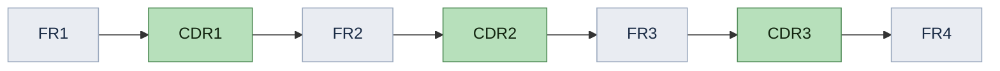
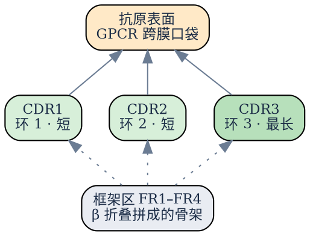

**CDR 是 complementarity-determining region 的缩写，中文叫“互补决定区”。** 它是抗体分子表面伸出来的三个小“手指”，能按抗原表面的形状去贴合；名字里的“互补”指的就是这种形状互补。
剩下的部分叫**框架区**（FR, framework region），像一副骨架，只负责撑住这三个环，本身不接触抗原。所以一条纳米抗体序列读起来像一串被框架区分隔开的环：

注意：**这三个 CDR 在序列上是分开的**，中间被大量框架区隔开。但在折叠成三维结构后，它们在空间上会聚到一起：

骨架是桶状结构，三个环像桶口伸出来的三根手指，共同构成**抗原结合面**（paratope）。这三个环合起来决定抗体能认什么，所以叫“决定区”。

## 普通抗体有六个环，纳米抗体只有三个环

||常规抗体 IgG|纳米抗体（VHH）|
|---|---|---|
|组成|重链 + 轻链，各一个可变区|只有一条重链可变区|
|CDR 数量|VH 三个 + VL 三个，共 **6 个**|**3 个**|
|分子量|约 150 kDa|约 15 kDa|
|CDR3 长度|10–15 aa|常达 **15–20+ aa**|

纳米抗体没有轻链，少了一半的结合面，于是**用更长的 CDR3 来补偿**。这解释了我们上一轮讨论里提到的现象：模型推荐的最优组合，CDR3 的替换权重特别大；它确实在抗体的功能上承担了主要作用。

