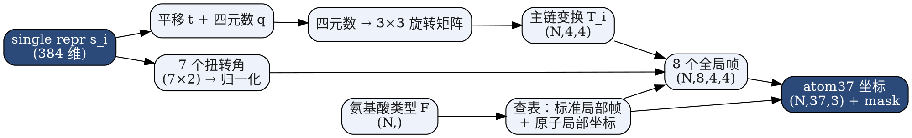
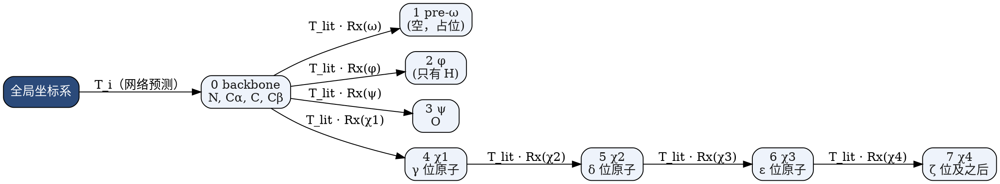

---
tags:
  - 生物
  - AlphaFold
---

> [!note] 本节要点
> - 每个残基的输出只有两类：一个刚体变换（平移加四元数）和 7 个扭转角，键长键角直接用晶体学标准值；
> - 角度不直接回归：扭转角预测二维向量归一化到单位圆，旋转预测 4 个数归一化成单位四元数，随机初始化时在旋转空间里分布均匀；
> - 每个残基建一个局部坐标系（原点在 Cα），8 个刚体帧组成一棵树，每个扭转帧的 x 轴沿对应可旋转键，绕键旋转就是乘 $R_x(\theta)$。

**网络为每个残基输出几十个数字，怎样把它们变成蛋白质里每个原子的三维坐标？**

每个残基只需要两类输出：
- **一个刚体变换**：一个平移加一个旋转，用来确定这个残基主链在空间里的位置和朝向。
- **7 个扭转角**：用来确定侧链怎样展开。

键长和键角基本是固定的，直接用晶体学测得的标准值。所以真正需要预测的只有“主链放在哪、朝哪”和“每根能转的键转了多少”。

## 1. AlphaFold 输出什么
对每个残基 $i$：

|输出|维度|含义|
|---|---|---|
|平移 $\mathbf t_i$|3|主链坐标系原点（Cα）的 $x, y, z$|
|四元数 $q_i$|4|主链坐标系的朝向|
|扭转角 $\alpha_i$|$7 \times 2$|$\omega, \varphi, \psi$ 和 $\chi_1 \sim \chi_4$，每个角用 2 个数表示|

字幕里这句被识别成了“Ω、F、P 和 φ”。实际上是 3 个主链扭转角 $\omega, \varphi, \psi$，加上 4 个侧链扭转角 $\chi_1 \sim \chi_4$。侧链有几个 $\chi$ 角要看氨基酸类型，比如 Gly、Ala 一个都没有。
整体数据流如下：

---

## 2. 为什么用四元数和“归一化向量”来表示

这一节讲的是神经网络输出层怎么设计，和几何本身关系不大。

**前提**：用 Xavier 或 He 初始化时，训练刚开始的输出大致是**独立的标准高斯**。如果这个“默认输出”本身就是一个合理的预测，模型学起来会容易很多。

- **平移**：直接预测 $x, y, z$ 就行。蛋白质大致是球状的，残基位置本来就像是围着中心的各向同性分布。
- **直接预测角度，效果不好**：
    - 如果 $\theta \sim \mathcal N(0,1)$，约 68% 的概率落在 $[-1, 1]$ rad 内，而这段只占整个圆周的 32%，所以预测会明显偏向 0。
    - 在 $\pm\pi$ 处还有跳变：$179^\circ$ 和 $-179^\circ$ 在几何上几乎一样，数值上却差得很远。
- **扭转角的做法**：预测一个 2 维向量，归一化到单位圆上，解释成 $(\cos\theta, \sin\theta)$，需要时再用 $\operatorname{atan2}$ 求出角度。2 维高斯各向同性，归一化后**在圆周上均匀分布**。
- **旋转的做法**：预测 4 个数并归一化，得到单位四元数。4 维高斯同样各向同性，归一化后在 $S^3$ 上均匀。再经过 $S^3 \to SO(3)$ 这个 2 对 1 的映射，得到的正好是**所有旋转上的均匀分布**。

几种旋转表示的对比：

|表示|参数数|随机输出时的情况|问题|
|---|---|---|---|
|欧拉角|3|在旋转空间里分布不均匀|万向锁，$\pm\pi$ 处跳变|
|直接输出 3×3 矩阵|9|一般不是合法的旋转|需要额外做正交化|
|单位四元数|4|归一化后在 $SO(3)$ 上均匀|$q$ 和 $-q$ 表示同一个旋转（在这里无害）|

## 3. 刚体变换
$T(\mathbf x) = R\mathbf x + \mathbf t$ 可以从两个角度理解：
1. **移动物体**：把物体从原来的位置搬到新位置。
2. **换坐标系**：物体原本用它自己的局部坐标描述，施加 $T$ 就是在更"全局"的坐标系里重新描述它。
AlphaFold 用的是第 2 种。先在每个残基的局部坐标系里摆好原子，再用主链变换把它们放到全局空间。

## 4. 在 AlphaFold 中的具体实现

### 4.1 主链坐标系
- **原点**在 Cα；
- **x 轴**指向 C；
- **y 轴**在 N–Cα–C 平面内，偏向 N 一侧。

N–Cα 和 Cα–C 两根键之间的夹角不是 90°，这正是第 3.3 节要允许输入不正交向量的原因。在这个坐标系里，C 固定在 x 轴上约 1.5 Å 处，N 固定在 xy 平面内，Cβ 的位置也固定。这些数值都来自晶体学统计。
### 4.2 8 个刚体组构成的树
每个残基有 8 个坐标（帧），每个帧负责摆放一部分原子：

**设计上的关键点**：每个扭转帧的 **x 轴都沿着对应的那根可旋转键**。这样"绕这根键转一个角度"就是乘一个 $R_x(\theta)$，下游所有原子会一起绕这根键转动。

- **ψ 帧**：原点在 C，x 轴沿 Cα→C，y 轴参考 N→Cα。它负责摆放**羰基氧 O**。
- **φ 帧**：原点在 N，x 轴沿 Cα→N。它下面只有氢原子，atom37 里不含氢，所以这个帧实际上不影响重原子。
- **pre-ω 帧**：恒等变换，只是占位，下面没有原子。

## 5. 简单一点，AlphaFold 的输出
每个残基的输出是：
1. **Cα 的坐标**：3 个数 $(x, y, z)$，决定这个残基放在哪里。
2. **一个四元数**：决定主链朝哪个方向，AlphaFold 会把它转成旋转矩阵。
3. **7 个扭转角**：$\omega, \varphi, \psi$ 这 3 个是主链的，$\chi_1 \sim \chi_4$ 这 4 个是侧链的。每个角用 $(\cos, \sin)$ 两个数表示。

前两项合起来，就是一个残基的“刚体变换”。

上一节：[[四元数]]　·　下一节：[[Structure Model]]　·　[[AlphaFold-Decode 课程总览|课程总览]]
