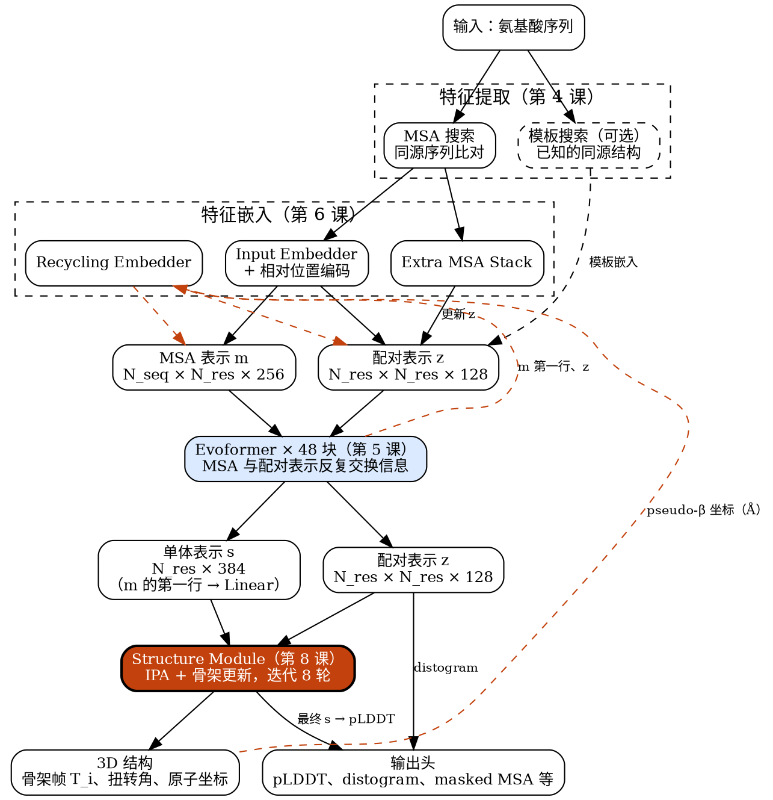
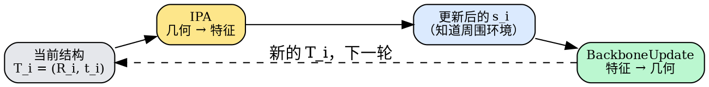

---
tags:
  - 生物
  - AlphaFold
---

> [!note] 本节要点
> - 结构模块是整个网络里唯一生成三维坐标的地方：输入是 Evoformer 的单体与配对两种抽象表示，输出每个残基的骨架刚体变换 $T_i$ 和扭转角；
> - 两层循环别混淆：外层 recycling 整网跑 4 遍，内层结构模块迭代 8 轮，一次完整推理共 32 轮；
> - IPA 只把几何信息转写进特征（“看”），真正移动残基的是后面的 BackboneUpdate（“动”）。

## 1. 结构模块在整个网络里的位置

图中橙色虚线是 recycling 回路：上一遍的输出重新送回输入端。课程编号已经对照过 GitHub 仓库 README 里的教程顺序。系列视频有没有实现模板部分我没核实，所以模板那一支画成了虚线的“可选”。
- **输入**：Evoformer 给出两种表示：
    - 单体表示 $\mathbf s_i$：每个残基一个向量；
    - 配对表示 $\mathbf z_{ij}$：每对残基一个向量。
- **要预测的东西**：
    - 每个残基的 **骨架刚体变换** $T_i = (R_i, \vec t_i)$。它以 Cα 为原点，用 N–Cα–C 三个原子确定朝向，相当于给每个残基一个局部坐标系；
    - 每个残基的 **扭转角**，用来确定侧链原子的位置。
- 有了 $T_i$ 和扭转角，再调用上一课写好的 `compute_all_atom_coordinates`，就能得到所有重原子的坐标。
在这个模块里，每个残基被当作一个可以自由移动、旋转的刚体（论文里叫 “residue gas”）。结构模块的任务就是一步步把这些刚体摆到正确的位置和朝向上。
### 读图要点
- **前后分工**：Evoformer 只处理抽象表示 $m$ 和 $z$，从头到尾不碰三维坐标。结构模块是整个网络里 **唯一** 生成坐标的地方。上一遍的结构只能以距离分箱的形式，通过 recycling 进入 $z$。
- **为什么只取 MSA 第一行**：MSA 表示的第一行对应要预测的目标序列本身，其余各行是同源序列。经过 48 块 Evoformer，同源序列里的进化信息已经汇总到第一行和 $z$ 中。所以结构模块只需要 $\mathbf s_i$（第一行经过 Linear）和 $\mathbf z_{ij}$ 这两个输入。
- **结构模块的输出去三个地方**：
    - 最终的三维结构；
    - pseudo-β 坐标，交给 Recycling Embedder；
    - 最后一轮的 $\mathbf s_i$，交给 pLDDT 置信度头。
### 结构模块的接口

|方向|张量|形状|来源 / 去向|
|---|---|---|---|
|输入|$\mathbf s_i$|$N_{res}\times 384$|Evoformer 输出的 MSA 第一行经过 Linear|
|输入|$\mathbf z_{ij}$|$N_{res}\times N_{res}\times 128$|Evoformer 输出的配对表示|
|输出|$T_i$、扭转角、原子坐标|—|最终预测结构|
|输出|pseudo-β|$N_{res}\times 3$|Recycling Embedder|
|输出|最终 $\mathbf s_i$|$N_{res}\times 384$|pLDDT 头|

### 两层循环，别混淆
- **外层 recycling**：整个网络，也就是“嵌入 → Evoformer → 结构模块”这一整条链，AF2 默认额外再跑 3 次，总共 4 遍。每一遍结构模块都从黑洞初始化重新开始。
- **内层 8 轮迭代**：只在结构模块内部进行，8 轮共享同一套权重，逐步细化骨架帧 $T_i$。
所以一次完整推理中，结构模块的主循环一共要跑 $4\times 8=32$ 轮。

## 2. IPA：Invariant Point Attention

### 2.1. IPA 是做什么的
IPA 在结构模块的每一轮迭代里做一件事：**让每个残基根据当前的 3D 结构观察周围，再把观察到的几何信息写回自己的特征向量 $\mathbf s_i$。**
IPA 本身不移动任何残基，它只更新特征。真正移动残基的是紧跟在后面的 BackboneUpdate。
- IPA：把几何信息转成特征（“看”）
- BackboneUpdate：根据特征更新几何（“动”）
### 2.2. 为什么需要这一步
Evoformer 输出的 $\mathbf s_i$ 和 $\mathbf z_{ij}$ 是抽象特征，**里面没有坐标**。AlphaFold2 不会一步直接预测出整个结构，而是迭代细化：开始时所有残基都堆在原点，然后分 8 轮逐步调整位置和朝向。
每一轮要决定残基 $i$ 往哪里移、怎么转，前提是知道**当前**的结构是什么样子，比如：
- 谁离我近？
- 它在我的哪个方向？
- 我和邻居是不是撞在一起了？
这些信息只存在于坐标系 $T_i = (R_i, \vec t_i)$ 里，$\mathbf s_i$ 里没有。IPA 的作用就是把 $T$ 里的几何信息转写成特征，让后面的 BackboneUpdate 能够用上。

### 输入和输出
- **输入**：单残基特征 $\mathbf s_i$、残基对特征 $\mathbf z_{ij}$，以及当前每个残基的坐标系 $T_i$
- **输出**：更新后的 $\mathbf s_i$，仍然是 384 维向量，**不是坐标**

上一节：[[3D Geometry]]　·　[[AlphaFold-Decode 课程总览|课程总览]]
